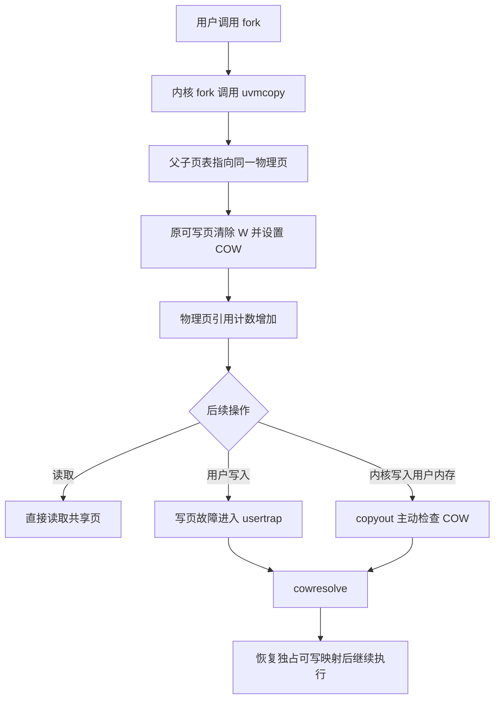
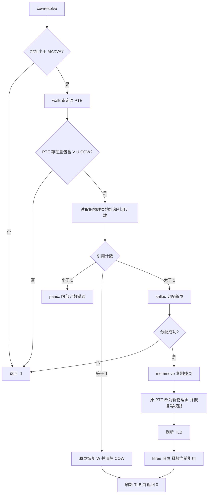

# xv6 COW 实验实现总结

本文对应当前代码，整理 Copy-on-Write fork 的实现思路、函数参数、调用流程、修改位置和常见错误。代码块中的注释用于解释逻辑，不代表源文件中已经添加了这些注释。

## 一、实验要解决什么问题

原来的 `fork()` 会为子进程分配物理页，并复制父进程的用户内存。即使子进程马上执行 `exec()`、丢弃这些内存，也已经付出了分配和复制的成本。

COW 的策略是：父子进程先共享物理页，只有某一方真正写入时，才为写入方复制页面。

这里与懒分配不同：懒分配可以只有虚拟地址、没有物理页；COW 已经存在有效的物理页映射，只是暂时关闭写权限。



## 二、修改位置总览

| 文件 | 修改的对象 | 作用 |
|---|---|---|
| `kernel/riscv.h` | `PTE_COW` | 用 PTE 第 8 位标识 COW 页 |
| `kernel/refcount.h` | `struct page_refcounts`、`extern lock_counting` | 共享引用计数类型和变量声明 |
| `kernel/kalloc.c` | `lock_counting`、`kinit()`、`freerange()`、`kalloc()`、`kfree()` | 分配和回收过程中维护引用计数 |
| `kernel/vm.c` | `uvmcopy()` | fork 时共享物理页，设置 COW 权限 |
| `kernel/vm.c` | 新增 `cowresolve()` | 统一解除一个页面的 COW 状态 |
| `kernel/vm.c` | `copyout()` | 内核写用户页之前主动处理 COW |
| `kernel/trap.c` | `usertrap()` | 将用户写页故障交给 `cowresolve()` |
| `kernel/defs.h` | `cowresolve()` 声明 | 让其他内核源文件可以调用该函数 |

本实验没有增加系统调用，也不需要新增用户态声明或 `usys.pl` 入口。用户仍调用原来的 `fork()`，变化发生在内核的内存管理实现中。

## 三、PTE 标记分别表示什么

```c
#define PTE_COW (1L << 8)
```

RISC-V 页表项有供软件使用的位，当前实现选择第 8 位记录 COW 状态。硬件不会因为这个位自动复制页面，真正触发写页故障的是 `PTE_W` 被清除。

| 状态 | `PTE_V` | `PTE_U` | `PTE_W` | `PTE_COW` |
|---|---|---|---|---|
| 普通用户可写页 | 1 | 1 | 1 | 0 |
| 用户 COW 页 | 1 | 1 | 0 | 1 |
| 用户只读代码页 | 1 | 1 | 0 | 0 |

只读代码页和 COW 页都不可写，但处理方式不同：COW 页可以恢复写权限；真正的只读页不能通过写异常获得写权限。

## 四、引用计数与共享变量

### 1. 为什么按物理页计数

父进程和子进程的页表项可以指向同一个物理页。删除一个映射时，其他进程可能仍在使用该页，因此不能直接回收。

当前数组的索引方式是：

```c
lock_counting.count[pa / PGSIZE]
```

`pa` 是物理页地址，除以每页字节数就得到物理页号。计数表示该页被持有的引用数量，分配时的初始持有也算一份引用，不能简单理解为“进程数量”。

`NPAGE = PHYSTOP / PGSIZE` 与这个绝对物理页号索引匹配，但会为空间起点以下的物理页号也保留数组位置。如果以后改成 `(PHYSTOP - KERNBASE) / PGSIZE`，所有索引也必须统一改成 `(pa - KERNBASE) / PGSIZE`。

### 2. 为什么需要 extern

头文件中：

```c
struct page_refcounts {
  struct spinlock lock;
  int count[NPAGE];
};

extern struct page_refcounts lock_counting;
```

结构体定义告诉编译器成员布局，`extern` 告诉编译器变量在其他地方有定义。实际分配存储空间的是 `kalloc.c` 中唯一的一句：

```c
struct page_refcounts lock_counting;
```

不能每个 `.c` 文件各定义一份变量，也不能只有 `extern` 而没有实际定义。前者产生重复定义，后者产生链接错误 `undefined reference`。

当前 `refcount.h` 依赖调用方先包含 `types.h`、`memlayout.h`、`riscv.h`、`spinlock.h`。其中分别提供类型、`PHYSTOP`、`PGSIZE` 和完整的锁结构。不要重复包含没有保护机制的 xv6 头文件。

### 3. 分配器函数说明

| 函数 | 参数和返回值 | 当前职责 |
|---|---|---|
| `kinit(void)` | 无参数 | 初始化空闲链表锁、计数锁，然后调用 `freerange()` |
| `freerange(pa_start, pa_end)` | 物理内存区间，上界不包含 | 逐页设置初始计数为 1，再通过 `kfree()` 加入空闲链表 |
| `kalloc(void)` | 成功返回物理页地址，失败返回 0 | 从空闲链表取出页面，并把计数设为 1 |
| `kfree(pa)` | 页对齐的物理页地址 | 减少一份引用，计数为 0 才真正回收 |

启动时计数本来是 0。`freerange()` 先设为 1，再调用 `kfree()` 减为 0，是为了复用同一套回收逻辑。

```c
for(; p + PGSIZE <= (char *)pa_end; p += PGSIZE){
  // 每个物理页都先初始化计数，再进入空闲链表。
  lock_counting.count[(uint64)p / PGSIZE] = 1;
  kfree(p);
}
```

两个语句必须都在循环内。缺少大括号时，循环结束后的 `p` 已到达内存上界，再执行 `kfree(p)` 就会 panic。

`kfree()` 的核心语义变成：

```c
// 在计数锁保护下减少一份引用。
count--;
if(count > 0)
  return;
// 只有最后一份引用消失后，才填充页面并加入空闲链表。
```

当前还会在计数已经非正时触发 `kfree refcount`，帮助发现重复释放。`kmem.lock` 保护空闲链表，`lock_counting.lock` 保护计数，两者职责不同。

## 五、uvmcopy：fork 时共享页面

```c
int uvmcopy(pagetable_t old, pagetable_t new, uint64 sz);
```

- `old`：父进程用户页表。
- `new`：正在构建的子进程用户页表。
- `sz`：要复制映射的用户地址空间大小，单位是字节。
- 返回值：成功为 0，失败为 -1。

当前每页的处理逻辑：

```c
if(*pte & PTE_W){
  // 只把原来可写的页变成 COW；真正只读的页保持只读。
  *pte &= ~PTE_W;
  *pte |= PTE_COW;
}
pa = PTE2PA(*pte);
flags = PTE_FLAGS(*pte);

// 子进程获得相同物理页的映射，不分配数据页、不复制数据。
if(mappages(new, i, PGSIZE, pa, flags) != 0)
  goto err;

// 映射建立成功后，该物理页多一份引用。
```

已带 COW 标记的页再次 fork 时，标记会保留下来，引用计数继续增加。只读页也需要增加计数，因为它同样被父子进程共享。

若中途失败，`uvmunmap(new, 0, i / PGSIZE, 1)` 移除已经建立的子进程映射，并通过 `kfree()` 撤销这些引用。父进程已经被改为 COW 的页不必强制改回；之后写入时，若只有一个引用，直接恢复写权限即可。

## 六、cowresolve：统一处理 COW

```c
int cowresolve(pagetable_t pagetable, uint64 va);
```

- `pagetable`：需要修改的目标页表，不能假定总是当前进程页表。
- `va`：该页中的虚拟地址，可以带页内偏移；`walk()` 根据页号找到 PTE。
- 返回值：处理成功为 0，地址或权限不合法、内存不足时为 -1。



### 1. 为什么 count == 1 不用复制

这时只有当前持有者使用旧页，没有其他共享者。保留同一个物理页，只恢复写权限即可。

### 2. 为什么不能先减计数

复制期间当前映射仍然依赖旧页。提前减计数后，其他进程释放引用可能让旧页被回收，导致复制已释放内存。分配失败时也会留下错误计数。

因此顺序必须是：分配新页、复制数据、替换 PTE、刷新相关缓存，最后释放旧引用。失败返回前不改变旧映射和计数。

### 3. 为什么不用 mappages

`mappages()` 用于建立尚不存在的映射。如果 PTE 已经有 `PTE_V`，它会报告 `mappages: remap`。

COW 页有有效映射，因此直接替换已经找到的 PTE：

```c
// 将普通物理地址编码进 PTE，而不是直接把地址与标志相加。
*pte = PA2PTE((uint64)mem) |
       ((flags | PTE_W) & ~PTE_COW);
```

`pte` 是页表项地址，`*pte` 是页表项的整数内容；`walk()` 的返回值赋给 `pte`，不是赋给 `*pte`。

### 4. 锁和 TLB 的作用

计数锁保证计数读写不互相覆盖。读取计数后释放锁，不代表整个复制过程都被锁住；复制期间的页面存活依赖当前仍持有的一份引用。

在当前 xv6 进程模型下，一个进程的用户页表不会被多个用户线程同时修改。计数为 1 时也不存在其他进程通过自己的映射 fork 出该页的新引用。若扩展为共享地址空间的多线程内核，需要重新设计页表同步。

TLB 缓存地址转换和权限，修改内存中的 PTE 后需保证旧转换不再使用。当前 `cowresolve()` 显式执行 `sfence_vma()`；返回用户态的 trampoline 路径也有刷新操作。

## 七、usertrap：用户写入触发的路径

```c
if(r_scause() == 15){
  // r_stval() 给出发生写页故障的虚拟地址。
  if(cowresolve(p->pagetable, r_stval()) < 0)
    setkilled(p);
}
```

`r_scause()` 读取异常原因，15 表示 store/AMO page fault。它不是“COW 专用异常”，所以仍必须由 `cowresolve()` 检查页表项的 COW 标记。

```text
用户执行写指令
→ 硬件发现 PTE_W 为 0
→ 进入 usertrap()
→ cowresolve() 解除 COW
→ usertrapret() 返回用户态
→ 重试原来的写指令
```

这里不能像系统调用那样把 `epc` 加 4：发生故障的写指令尚未完成，必须重试。如果处理失败，设置 killed，随后由 `usertrap()` 的统一检查调用 `exit(-1)`。

## 八、copyout：内核写用户内存的路径

```c
int copyout(pagetable_t pagetable, uint64 dstva,
            char *src, uint64 len);
```

| 参数 | 含义 |
|---|---|
| `pagetable` | 写入目标的用户页表 |
| `dstva` | 目标用户虚拟地址 |
| `src` | 内核源缓冲区地址 |
| `len` | 要复制的字节数 |

内核通过物理地址映射写入用户数据页，不会依赖用户页表的写权限自动触发用户态 COW 异常。因此需要主动检查：

```text
检查目标页存在且允许用户访问
→ 若有 PTE_COW，调用 cowresolve()
→ 确认 PTE_W 已开启
→ 重新取得物理地址
→ 复制本页范围内的数据
→ 如果还有剩余数据，处理下一页
```

注意两点：

1. 始终使用传入的 `pagetable`。`exec()` 构建新地址空间时，它可能不同于 `myproc()->pagetable`。
2. 失败返回 `-1`，不在这里直接 `exit()`。调用者需要有机会释放锁、清理临时资源。

页内复制长度计算为：

```c
va0 = PGROUNDDOWN(dstva);
n = PGSIZE - (dstva - va0);
if(n > len)
  n = len;
```

`dstva - va0` 是页内偏移，`n` 保证本次不会跨越当前页；下一页可能映射到完全不同的物理地址，需要重新查询。

## 九、完整生命周期示例

假设父进程的虚拟页原来映射到物理页 A：

| 时刻 | 父进程 | 子进程 | A 的计数 | B 的计数 |
|---|---|---|---|---|
| fork 前 | A，可写 | 无 | 1 | 无 |
| fork 后 | A，COW | A，COW | 2 | 无 |
| 子进程写入后 | A，COW | B，可写 | 1 | 1 |
| 父进程再写入 | A，可写，无需复制 | B，可写 | 1 | 1 |
| 子进程退出 | A，可写 | 释放 B | 1 | 0，回收 |
| 父进程退出 | 释放 A | 已退出 | 0，回收 | 已回收 |

退出、缩小地址空间、替换旧地址空间等路径最终通过 `uvmunmap(..., do_free=1)` 调用 `kfree()`，所以修改 `kfree()` 后，这些已有路径能够统一处理共享页释放。

## 十、验证与排错

本次实现完成时运行了 `make grade`：

- `cowtest` 的 `simple`、`three`、`file`、`forkfork` 全部通过。
- 完整 `usertests` 通过，包括 `copyin` 和 `copyout`。
- 得分为 129/130，唯一失败项为缺少 `time.txt`。该文件应按实验要求填写实际耗时。

| 现象 | 对应原因 |
|---|---|
| `undefined reference to lock_counting` | 只有 extern 声明，没有实际变量定义 |
| `struct spinlock` 类型不完整 | 使用结构体前尚未包含完整定义 |
| 大量 `riscv.h` 函数重复定义 | 重复包含缺少完整保护的头文件 |
| 启动立即 `panic: kfree` | 曾因 freerange 循环缺大括号而释放到内存上界 |
| `panic: mappages: remap` | 对有效 COW 映射再次调用 mappages |
| fork 后父子数据相互影响 | 共享可写映射，或 copyout 未解除 COW |
| 写代码页居然成功 | 把非 COW 的只读页也恢复成可写 |
| 内存不足后计数错乱 | 在分配成功和替换映射之前就减少旧引用 |

实现 COW 最需要保持的关系是：共享页的每份有效持有都有对应计数；写入前必须取得可写的独占数据页；最后一份引用消失时才回收物理页。
