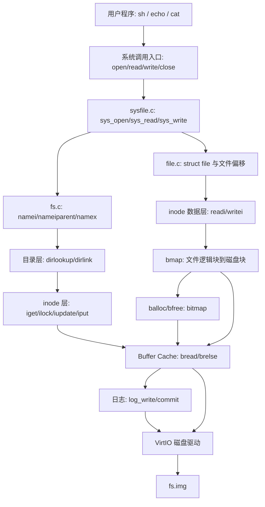

# xv6 FS Lab 详细笔记：大文件、符号链接与完整文件系统调用链

本文结合当前 xv6 FS Lab，系统总结两个实验：

1. `bigfile`：为 inode 增加二级间接块，使文件能够保存 65803 个数据块。
2. `symlink`：增加符号链接系统调用，并让 `open()` 能选择跟随或不跟随链接。

最后将从用户程序、系统调用、文件描述符、路径、inode、磁盘块、日志、Buffer Cache 一直追踪到 VirtIO 磁盘，并详细分析：

```sh
echo "hi" > x
cat x
```

---

## 1. 文件系统的整体分层

先不要急着阅读某一个函数。xv6 文件操作可以分成以下层次：



需要区分四个重要对象：

| 对象 | 所在位置 | 作用 |
|---|---|---|
| 文件描述符 `fd` | 单个进程的 `ofile[]` | 用户态使用的小整数，如 3 |
| `struct file` | 全局文件表 `ftable` | 保存权限、当前偏移 `off`、对应 inode |
| `struct inode` | 内存 inode cache | 某个磁盘 inode 的内存副本，带锁和引用计数 |
| `struct dinode` | 磁盘 inode 区 | 文件持久化元数据：类型、大小、块地址等 |

关系如下：

```text
进程 fd=3
   ↓ p->ofile[3]
struct file（off、readable、writable）
   ↓ f->ip
struct inode（内存对象）
   ↓ dev + inum
struct dinode（磁盘对象）
   ↓ addrs[]
文件数据块 / 间接索引块
```

---

## 2. 磁盘布局和三种编号

xv6 的文件系统镜像大致如下：

```text
[boot][superblock][log][inode blocks][bitmap blocks][data blocks]
```

- Superblock：记录整个文件系统各区域的位置和大小。
- Log：保存尚未安装到正式位置的事务修改。
- Inode blocks：保存 `struct dinode`。
- Bitmap：每一位表示一个磁盘块是否已经被分配。
- Data blocks：保存普通文件内容、目录项和间接索引表。

必须区分：

| 编号 | 示例 | 含义 |
|---|---:|---|
| 文件逻辑块号 `bn` | 12 | 文件内部第几个块，从 0 开始 |
| 磁盘块号 `addr` | 846 | `fs.img` 中真正的块号 |
| inode 编号 `inum` | 21 | inode 表中的编号 |

`bmap(ip, bn)` 做的是：

```text
文件逻辑块号 bn → 磁盘块号 addr
```

它不是虚拟地址到物理地址的页表映射。

---

# 第一部分：bigfile 实验

## 3. 原始 xv6 为什么不能保存大文件

原始 inode 使用：

```text
12 个直接块地址 + 1 个一级间接块地址
```

一个磁盘块大小为 `BSIZE=1024`，一个块号 `uint` 为 4 字节，所以一级间接块可以保存：

```text
NINDIRECT = BSIZE / sizeof(uint)
          = 1024 / 4
          = 256
```

原始最大文件块数：

```text
12 + 256 = 268 块
```

实验要求增加二级间接块。为了保持磁盘 inode 大小不变，不能简单增加一个地址槽，而是把直接地址从 12 个减少到 11 个：

```text
11 个直接地址 + 1 个一级间接地址 + 1 个二级间接地址
```

因此：

```c
#define NDIRECT 11
#define NINDIRECT (BSIZE / sizeof(uint))
#define MAXFILE (NDIRECT + NINDIRECT + NINDIRECT*NINDIRECT)
```

最大数据块数量：

```text
11 + 256 + 256×256 = 65803
```

这就是 `bigfile` 期望写入 `65803` 个块的原因。

## 4. bigfile 的 inode 布局

```text
ip->addrs[0..10]  ─────────────→ 11 个直接数据块

ip->addrs[11] ────────────────→ 一级间接块
                                  ├─ a[0]   → 数据块
                                  ├─ a[1]   → 数据块
                                  └─ a[255] → 数据块

ip->addrs[12] ────────────────→ 二级间接块（第一层）
                                  ├─ first[0]   → 第二层索引块
                                  │                ├─ second[0] → 数据块
                                  │                └─ second[255] → 数据块
                                  └─ first[255] → 第二层索引块
                                                   └─ second[255] → 数据块
```

磁盘 inode 和内存 inode 必须同时保持 `NDIRECT+2`：

```c
// kernel/fs.h: struct dinode
uint addrs[NDIRECT+2];

// kernel/file.h: struct inode
uint addrs[NDIRECT+2];
```

如果只有 `dinode` 修改，而内存 inode 仍然是 `NDIRECT+1`，访问 `ip->addrs[NDIRECT+1]` 就会越界并破坏相邻内存。

## 5. `bmap()` 的核心逻辑

函数原型：

```c
static uint bmap(struct inode *ip, uint bn);
```

参数：

- `ip`：目标文件的内存 inode，调用者必须持有 `ip->lock`。
- `bn`：文件内部的逻辑块号，不是磁盘块号。

返回值：

- 成功：对应的磁盘块号。
- 磁盘空间不足：`0`。
- `bn >= MAXFILE`：panic。

重要特性：`bmap()` 不只是查询。如果某级索引块或数据块不存在，它会调用 `balloc()` 分配。

### 5.1 直接块

```text
条件：bn < NDIRECT
结果：ip->addrs[bn]
```

如果地址为 0，就分配一个数据块并保存到 inode。

### 5.2 一级间接块

先减去直接块数量：

```c
bn -= NDIRECT;
```

当 `bn < NINDIRECT` 时：

1. 检查 `ip->addrs[NDIRECT]`，必要时分配一级索引块。
2. `bread()` 读取该索引块。
3. 把 `bp->data` 解释成 `uint a[NINDIRECT]`。
4. 使用 `a[bn]` 查找数据块，必要时分配。
5. 修改索引表后调用 `log_write(bp)`。
6. `brelse(bp)` 释放 buffer。

### 5.3 二级间接块

再减去一级间接块覆盖的范围：

```c
bn -= NINDIRECT;
```

计算两级索引：

```c
uint first  = bn / NINDIRECT;
uint second = bn % NINDIRECT;
```

例如二级区域中的 `bn=515`：

```text
first  = 515 / 256 = 2
second = 515 % 256 = 3
```

访问路径：

```text
ip->addrs[12]
   → 第一层索引块的 first[2]
   → 第二层索引块的 second[3]
   → 最终数据块
```

每次修改索引块都必须 `log_write()`，因为索引关系同样属于文件系统元数据。

## 6. `itrunc()` 为什么也必须修改

`itrunc(struct inode *ip)` 负责释放文件的全部数据块。增加二级间接块后，释放顺序必须从叶子向根进行：

```mermaid
flowchart TD
    A[读取一级的第一层索引块] --> B[遍历 first 0..255]
    B --> C{first[j] 是否非 0}
    C -- 是 --> D[读取第二层索引块]
    D --> E[释放 second 0..255 指向的数据块]
    E --> F[释放第二层索引块本身]
    F --> B
    C -- 否 --> B
    B --> G[释放第一层索引块本身]
    G --> H[ip->addrs 对应项清零]
```

不能先释放索引块再读取其中的地址，否则将失去所有子块的位置。最后需要：

```c
ip->size = 0;
iupdate(ip);
```

## 7. bigfile 的完整写入路径

`bigfile` 每次调用 `write(fd, buf, BSIZE)`：

```text
write
→ sys_write
→ argfd：fd 转为 struct file*
→ filewrite
→ begin_op
→ ilock(f->ip)
→ writei(ip, user_src=1, src, f->off, BSIZE)
→ bmap(ip, off/BSIZE)
→ 必要时 balloc 索引块或数据块
→ bread 数据块
→ either_copyin：用户缓冲区复制到 bp->data
→ log_write
→ brelse
→ iupdate：更新 inode 大小和 addrs[]
→ iunlock
→ end_op：必要时提交日志
→ 更新 f->off
```

`filewrite()` 会把大写入拆成多个事务，原因是一次事务可容纳的日志块数量有限。

---

# 第二部分：symlink 实验

## 8. 硬链接与符号链接的区别

硬链接保存的是 inode 编号：

```text
目录项 a ─┐
          ├→ 同一个 inode → 数据
目录项 b ─┘
```

符号链接拥有自己的 inode，其文件内容是一段目标路径：

```text
目录项 b → symlink inode → 内容 "/test/a"
                              ↓ open 时重新 namei
目录项 a → 普通文件 inode → 数据
```

所以目标文件不存在时，创建符号链接仍然可以成功，这叫悬空链接。

## 9. 增加一个系统调用需要哪些位置

完整调用链：

```text
用户 symlink(target, path)
→ user.h 函数声明
→ usys.pl 生成汇编桩
→ a7 = SYS_symlink，执行 ecall
→ usertrap → syscall
→ syscall.h 提供编号
→ syscall.c 的 syscalls[] 查表
→ sys_symlink()
```

需要修改的位置及原因：

| 文件 | 内容 | 原因 |
|---|---|---|
| `kernel/stat.h` | `T_SYMLINK` | inode 需要新类型 |
| `kernel/fcntl.h` | `O_NOFOLLOW` | 允许打开链接本身 |
| `kernel/syscall.h` | `SYS_symlink` | 系统调用编号 |
| `kernel/syscall.c` | 声明和分发表项 | 编号映射到处理函数 |
| `user/user.h` | 用户态声明 | C 编译器知道接口 |
| `user/usys.pl` | `entry("symlink")` | 生成 `ecall` 汇编桩 |
| `kernel/sysfile.c` | `sys_symlink()` | 实现创建逻辑 |
| `kernel/sysfile.c` | 修改 `sys_open()` | 打开时解析链接 |
| `Makefile` | `_symlinktest` | 把测试程序写入 fs.img |

## 10. `sys_symlink()` 的逻辑

接口语义：

```c
int symlink(const char *target, const char *path);
```

- `target`：链接中保存的目标路径，可以暂时不存在。
- `path`：要创建的符号链接名称。
- 成功返回 `0`，失败返回 `-1`。

内核实现步骤：

1. `argstr(0, target, MAXPATH)`：从用户地址空间复制第一个字符串参数。
2. `argstr(1, path, MAXPATH)`：复制第二个字符串参数。
3. `begin_op()`：进入文件系统事务。
4. `create(path, T_SYMLINK, 0, 0)`：创建符号链接 inode，并保持 inode 锁。
5. `writei(ip, 0, (uint64)target, 0, strlen(target)+1)`：把目标路径作为 inode 数据保存。
6. `iunlockput(ip)`：解锁并减少 inode 引用。
7. `end_op()`：结束事务并可能触发提交。

这里 `writei()` 的 `user_src=0`，因为 `argstr()` 已经把字符串复制到内核栈；`target` 此时是内核地址。

## 11. `sys_open()` 如何跟随符号链接

普通 `namei(path)` 只查找 `path` 对应的 inode，不自动解释 `T_SYMLINK`。因此 `sys_open()` 必须增加循环：

```text
namei(path) → ilock(ip)
       ↓
ip 是 T_SYMLINK 且没有 O_NOFOLLOW？
       ├─ 否：继续普通 open
       └─ 是：
            readi 读取目标路径
            iunlockput 当前链接 inode
            namei(target)
            ilock 新 inode
            回到判断
```

关键条件是：

```c
ip->type == T_SYMLINK && !(omode & O_NOFOLLOW)
```

- 普通 `open("b", O_RDONLY)`：跟随 `b`，最终打开目标文件。
- `open("b", O_RDONLY | O_NOFOLLOW)`：不跟随，打开 `b` 的符号链接 inode 本身。

每次解析后必须释放旧 inode：

```c
iunlockput(ip);
```

然后再执行：

```c
ip = namei(target);
ilock(ip);
```

必须限制解析深度，例如 10 次，以处理：

```text
a → b
b → a
```

超出深度后返回 `-1`，并确保使用 `iunlockput(ip)` 同时释放锁和引用。

## 12. 符号链接例子

假设执行：

```c
symlink("/README", "/readme-link");
```

创建后：

```text
/readme-link 的目录项
  → inode 类型 T_SYMLINK
  → inode 数据块内容 "/README\0"
```

执行：

```c
open("/readme-link", O_RDONLY);
```

得到的 `struct file->ip` 是 `/README` 的 inode。

执行：

```c
open("/readme-link", O_RDONLY | O_NOFOLLOW);
```

得到的 `struct file->ip` 是 `/readme-link` 自己的 symlink inode，因此 `fstat()` 能看到 `T_SYMLINK`。

---

# 第三部分：关键函数参数与作用

## 13. 系统调用与文件描述符层

### `argfd(int n, int *pfd, struct file **pf)`

- `n`：第几个系统调用参数。
- `pfd`：非空时返回整数 fd。
- `pf`：非空时返回 `struct file *`。
- 作用：检查 fd 范围，并通过 `myproc()->ofile[fd]` 找到打开文件对象。

### `fdalloc(struct file *f)`

- `f`：已经由 `filealloc()` 分配的文件对象。
- 作用：在当前进程 `ofile[]` 中找空槽，返回 fd。
- 注意：它不创建 inode，也不分配全局 `struct file`。

### `filealloc(void)`

- 无参数。
- 在全局 `ftable.file[]` 中寻找 `ref==0` 的对象，设置 `ref=1`。
- 返回 `struct file *` 或 `0`。

### `fileread(struct file *f, uint64 addr, int n)`

- `f`：打开文件对象。
- `addr`：用户空间目标缓冲区地址。
- `n`：希望读取的字节数。
- 对 inode 文件调用 `readi(f->ip, 1, addr, f->off, n)`，成功后推进 `f->off`。

### `filewrite(struct file *f, uint64 addr, int n)`

- `addr`：用户空间源缓冲区地址。
- 将写入拆成日志能容纳的若干段。
- 每段执行 `begin_op → ilock → writei → iunlock → end_op`。
- 成功后推进 `f->off`。

### `fileclose(struct file *f)`

- 减少 `struct file.ref`。
- 最后一个引用关闭时，对 inode 文件执行事务中的 `iput()`。
- fd 槽由 `sys_close()` 先清空。

## 14. 路径和目录层

### `namei(char *path)`

- 返回完整路径对应 inode 的引用。
- 返回的 inode 没有加 inode 睡眠锁，使用内容前需 `ilock()`。

### `nameiparent(char *path, char *name)`

- 返回父目录 inode。
- 把最后一个路径分量写入 `name`。
- 例如 `nameiparent("/a/b/x", name)` 返回 `/a/b` inode，并使 `name="x"`。

### `namex(char *path, int nameiparent, char *name)`

- 路径解析核心。
- 绝对路径从根 inode 开始，相对路径从 `myproc()->cwd` 开始。
- 循环调用 `skipelem()` 和 `dirlookup()`。

### `skipelem(char *path, char *name)`

- 提取下一个路径分量。
- 例如输入 `"/a/b/x"`，第一次把 `a` 放入 `name`，返回指向 `b/x` 的指针。

### `dirlookup(struct inode *dp, char *name, uint *poff)`

- `dp`：已锁定的目录 inode。
- `name`：要查找的文件名。
- `poff`：非空时返回目录项在目录文件中的字节偏移。
- 目录本质也是文件，函数使用 `readi()` 遍历 `struct dirent`。

### `dirlink(struct inode *dp, char *name, uint inum)`

- 在目录 `dp` 中新增 `(name, inum)`。
- 先防止重名，再找空目录项，最后使用 `writei()` 写入。

### `create(char *path, short type, short major, short minor)`

- `path`：要创建的路径。
- `type`：`T_FILE`、`T_DIR`、`T_DEVICE` 或 `T_SYMLINK`。
- `major/minor`：只对设备文件有意义。
- 成功返回已锁定的 inode；调用者必须 `iunlock()` 或 `iunlockput()`。

## 15. inode 层

### `iget(uint dev, uint inum)`

- 获得内存 inode cache 中的引用，只增加 `ref`。
- 不加 inode 睡眠锁，也不保证元数据已经从磁盘载入。

### `ilock(struct inode *ip)` / `iunlock(struct inode *ip)`

- 获取/释放 inode 睡眠锁。
- 第一次 `ilock()` 会读取磁盘 `dinode` 并填充内存 inode。

### `iupdate(struct inode *ip)`

- 调用者必须持有 inode 锁。
- 把 `type/nlink/size/addrs[]` 等写回对应的磁盘 inode buffer。
- 调用 `log_write()`，不是直接写最终磁盘位置。

### `iput(struct inode *ip)`

- 减少内存引用 `ref`。
- 若 `ref==1 && nlink==0`，说明这是最后一个内存引用且目录中已无链接，会执行 `itrunc()` 并释放磁盘 inode。

### `ialloc(uint dev, short type)`

- 扫描 inode blocks，寻找 `dinode.type==0` 的槽位。
- 初始化 inode 类型并记录日志，返回 `iget(dev, inum)`。

## 16. 数据块和 Buffer Cache 层

### `readi(ip, user_dst, dst, off, n)`

- `user_dst=1`：`dst` 是用户虚拟地址，使用 `copyout()`。
- `user_dst=0`：`dst` 是内核地址，使用 `memmove()`。
- `off`：文件内字节偏移。
- `n`：最多读取字节数。
- 通过 `bmap()` 找块、`bread()` 取 buffer，再复制数据。

### `writei(ip, user_src, src, off, n)`

- `user_src=1`：从用户虚拟地址复制，典型调用是普通 `write()`。
- `user_src=0`：从内核地址复制，典型调用是 `dirlink()` 或 `sys_symlink()`。
- 必要时由 `bmap()` 分配磁盘块。
- 修改数据块后 `log_write()`，最后更新 inode 大小并 `iupdate()`。

### `balloc(uint dev)` / `bfree(int dev, uint b)`

- `balloc()` 在 bitmap 中找 0 bit，改为 1，清零新块并返回磁盘块号。
- `bfree()` 把对应 bit 清零；重复释放会 panic。

### `bread(uint dev, uint blockno)`

- 返回指定磁盘块的已锁定 `struct buf *`。
- 若不在缓存中，会通过 `virtio_disk_rw()` 读盘。

### `brelse(struct buf *b)`

- 释放 buffer 睡眠锁和引用。
- 不等于写盘，调用后不可继续访问 `b->data`。

### `log_write(struct buf *b)`

- 记录“这个磁盘块已被当前事务修改”。
- 对同一磁盘块进行日志吸收，事务中只登记一次。
- pin 住 buffer，直到 commit 完成。

## 17. 日志事务

```text
begin_op
   ↓
修改多个缓存块并 log_write
   ↓
end_op
   ↓ 最后一个文件系统操作离开时
write_log：缓存块复制到日志数据区
   ↓
write_head：写日志头，事务在此刻正式提交
   ↓
install_trans：日志内容复制到正式磁盘块
   ↓
清空日志头
```

日志保证一次文件系统操作涉及的 inode、目录项、bitmap 和数据块修改不会在崩溃后只完成一半。

---

# 第四部分：`echo "hi" > x` 的完整调用过程

## 18. Shell 先解析重定向

输入：

```sh
echo "hi" > x
```

Shell 将其解析为：

```text
REDIRCMD
├─ command: echo "hi"
├─ file: x
├─ mode: O_WRONLY | O_CREATE | O_TRUNC
└─ fd: 1
```

这里 `>` 不是传给 `echo` 的参数。它由 shell 自己处理。

## 19. Shell 建立标准输出重定向

子进程大致执行：

```c
close(1);
open("x", O_WRONLY | O_CREATE | O_TRUNC);
exec("echo", argv);
```

因为 fd 1 刚刚被关闭，`fdalloc()` 从低到高找空位，新打开的 `x` 通常正好得到 fd 1。之后 `echo` 对 fd 1 的 `write()` 就写进 `x`，而不是 console。

## 20. `open("x", O_CREATE|O_TRUNC|O_WRONLY)`

### 第一步：进入内核

用户态 `open` 汇编桩把 `SYS_open` 放进 `a7`，执行 `ecall`。参数按 RISC-V ABI 已经在：

```text
a0 = 用户字符串 "x" 的地址
a1 = omode
```

`usertrap()` 识别用户系统调用，`syscall()` 根据 `a7` 调用 `sys_open()`。

### 第二步：复制参数并开始事务

```c
argstr(0, path, MAXPATH);  // 用户 "x" → 内核 path[]
argint(1, &omode);
begin_op();
```

### 第三步：创建文件

因为有 `O_CREATE`：

```c
create("x", T_FILE, 0, 0);
```

`create()` 内部：

1. `nameiparent("x", name)` 返回当前目录 inode，`name="x"`。
2. `ilock(dp)` 锁定目录。
3. `dirlookup(dp, "x", 0)` 检查是否已经存在。
4. 若不存在，`ialloc(dp->dev, T_FILE)` 分配磁盘 inode。
5. `ilock(ip)` 锁定新 inode。
6. 设置 `major/minor/nlink=1`。
7. `iupdate(ip)` 把 inode 元数据加入日志。
8. `dirlink(dp, "x", ip->inum)` 在父目录文件中写入目录项。
9. `iunlockput(dp)` 释放父目录。
10. 返回仍然加锁的新文件 inode。

目录项大致是：

```text
struct dirent {
  ushort inum = 新 inode 编号;
  char name[DIRSIZ] = "x";
}
```

### 第四步：建立 fd

```text
filealloc() → 全局 struct file
fdalloc(f)  → 当前进程最低空闲 fd，通常是 1
```

初始化：

```c
f->type = FD_INODE;
f->ip = ip;
f->off = 0;
f->readable = 0;
f->writable = 1;
```

若旧文件已经存在且设置 `O_TRUNC`，`itrunc(ip)` 会释放旧数据块并把大小设为 0。

最后 `iunlock(ip)`、`end_op()`，日志提交后返回 fd 1。

## 21. `echo` 执行 `write(1, "hi\n", 3)`

`echo` 通常写入三个字节：`h`、`i`、换行符。

### 系统调用层

```text
write(1, user_buf, 3)
→ sys_write()
→ argaddr(1, &p)
→ argint(2, &n)
→ argfd(0, 0, &f)
→ filewrite(f, p, 3)
```

### `filewrite()` 层

检查 `f->writable`，随后：

```text
begin_op
ilock(f->ip)
writei(f->ip, 1, user_buf, f->off=0, n=3)
iunlock
end_op
f->off += 3
```

### `writei()` 层

1. `off/BSIZE = 0`，所以请求文件逻辑块 0。
2. `bmap(ip, 0)` 发现 `ip->addrs[0]==0`。
3. `balloc()` 扫描 bitmap，选择一个空闲磁盘块。
4. bitmap 的 bit 被设为 1，并通过 `log_write()` 登记。
5. 新数据块被 `bzero()` 清零。
6. `ip->addrs[0]` 保存新块号。
7. `bread(ip->dev, addr)` 获得数据块 buffer。
8. `either_copyin(..., user_src=1, src=user_buf, 3)` 调用 `copyin()`，把 `hi\n` 从用户页表复制到 `bp->data[0..2]`。
9. `log_write(bp)` 登记数据块修改。
10. `brelse(bp)` 释放 buffer。
11. `ip->size` 从 0 更新为 3。
12. `iupdate(ip)` 登记 inode block 修改。

### 提交日志

最后一个 `end_op()` 触发 commit：

```text
bitmap block、数据 block、inode block
       ↓ write_log
日志数据区
       ↓ write_head（原子提交点）
日志头记录这些正式块号
       ↓ install_trans
复制到各自正式位置
       ↓
清空日志头
```

此时文件 `x` 的逻辑状态为：

```text
目录项 "x" → inode
inode.size = 3
inode.addrs[0] → 某数据块
数据块开头 = 68 69 0a，即 "hi\n"
```

## 22. `echo` 退出与关闭文件

进程退出会关闭 fd 1：

```text
fileclose(f)
→ f->ref--
→ 最后一个 file 引用时 iput(f->ip)
```

文件不会被删除，因为目录项 `x` 仍存在，inode 的 `nlink==1`。

---

# 第五部分：读取文件 `cat x`

## 23. `cat` 打开文件

`cat` 调用：

```c
fd = open("x", O_RDONLY);
```

因为没有 `O_CREATE`，`sys_open()` 执行：

```text
begin_op
namei("x")
→ namex 从 cwd 开始
→ ilock(cwd)
→ dirlookup(cwd, "x")
→ readi 逐个读取目录项
→ 找到 inum
→ iget(dev, inum)
→ 返回 x 的 inode 引用
ilock(x inode)
```

如果 inode cache 中该 inode 的 `valid==0`，`ilock()` 会：

1. 根据 `IBLOCK(inum, sb)` 计算 inode 所在磁盘块。
2. `bread()` 读取 inode block。
3. 定位块内的 `struct dinode`。
4. 将 `type/nlink/size/addrs[]` 复制到内存 inode。
5. 设置 `valid=1`。

然后 `filealloc()` 和 `fdalloc()` 创建只读 `struct file`：

```text
f->readable = 1
f->writable = 0
f->off = 0
f->ip = x inode
```

## 24. `cat` 调用 `read(fd, buf, sizeof(buf))`

调用链：

```text
read(fd, user_buf, n)
→ sys_read
→ argfd 找到 struct file
→ fileread(f, user_buf, n)
→ ilock(f->ip)
→ readi(ip, user_dst=1, user_buf, f->off, n)
```

`readi()` 发现文件大小只有 3 字节，因此把 `n` 缩小为 3：

```text
bn = off / BSIZE = 0
块内偏移 = off % BSIZE = 0
bmap(ip, 0) → ip->addrs[0] → 磁盘块号
bread(dev, blockno) → 已锁定 buffer
either_copyout(user_dst=1, user_buf, bp->data, 3)
→ copyout(myproc()->pagetable, ...)
brelse(bp)
return 3
```

`fileread()` 将：

```c
f->off += 3;
```

所以同一个 fd 下一次读取从偏移 3 开始，而不是重新从文件开头开始。

## 25. `cat` 把内容写到终端

`cat` 收到 `"hi\n"` 后调用：

```c
write(1, buf, 3);
```

但这次 fd 1 对应 console 设备，不是普通 inode 文件。调用链变成：

```text
sys_write
→ filewrite
→ f->type == FD_DEVICE
→ devsw[CONSOLE].write
→ consolewrite
→ uartputc
→ 终端显示 hi
```

因此 `cat x` 实际包含两条不同的 I/O 路径：

```text
磁盘文件 x → readi → 用户 buf
用户 buf → consolewrite → UART
```

下一次 `read()` 时 `off==size==3`，`readi()` 返回 0，表示 EOF。`cat` 随后关闭 fd 并退出。

---

# 第六部分：把所有调用关系串起来

## 26. 创建并写文件的总调用链

```text
用户 open(O_CREATE)
  → sys_open
    → begin_op
    → create
      → nameiparent → namex → skipelem → dirlookup
      → ialloc → bread → log_write
      → iget → ilock
      → iupdate → bread → log_write
      → dirlink → readi/writei
    → filealloc
    → fdalloc
    → end_op → commit

用户 write
  → sys_write → argfd
  → filewrite
    → begin_op
    → ilock
    → writei
      → bmap
        → balloc
          → bread(bitmap) → log_write
          → bzero → bread(data) → log_write
      → bread(data)
      → copyin
      → log_write(data)
      → iupdate → log_write(inode block)
    → iunlock
    → end_op → commit
      → write_log → bwrite → virtio_disk_rw
      → write_head
      → install_trans
```

## 27. 打开并读文件的总调用链

```text
用户 open(O_RDONLY)
  → sys_open
    → begin_op
    → namei → namex
      → skipelem
      → ilock(directory)
      → dirlookup
        → readi(directory)
          → bmap → bread
      → iget(target inode)
    → ilock(target inode)
      → 必要时 bread(inode block)
    → filealloc → fdalloc
    → iunlock
    → end_op

用户 read
  → sys_read → argfd
  → fileread
    → ilock
    → readi
      → bmap
      → bread(data block)
      → copyout 到用户地址空间
      → brelse
    → 推进 f->off
    → iunlock
```

## 28. 最后必须掌握的边界

1. `fd` 只是进程内的小整数，不是 inode 编号。
2. `struct file.off` 属于一次打开实例；同一 inode 可以被多次打开并拥有不同偏移。
3. `namei()` 返回 inode 引用，不返回文件内容。
4. `iget()` 不等于读取磁盘；真正加载元数据通常发生在 `ilock()`。
5. `bmap()` 参数是文件逻辑块号，返回磁盘块号。
6. `bread()` 返回的是锁定的缓存块；使用后必须 `brelse()`。
7. 修改文件系统 buffer 后要 `log_write()`，不能把 `brelse()` 当作写盘。
8. `begin_op()/end_op()` 定义事务边界，保证多块更新的一致性。
9. `ref` 是内存引用数，`nlink` 是磁盘目录链接数，两者不能混淆。
10. bigfile 增加了地址层级，因此 `bmap()` 和 `itrunc()` 必须成对修改。
11. symlink inode 保存路径字符串；普通 `open()` 需要再次 `namei()` 目标路径。
12. `O_NOFOLLOW` 表示停止解析，让调用者操作符号链接 inode 本身。

掌握这些关系后，阅读 xv6 文件系统代码时可以始终追问四件事：当前持有什么锁、持有什么引用、当前地址属于用户还是内核、当前修改是否位于日志事务中。这四点几乎决定了文件系统代码是否正确。
