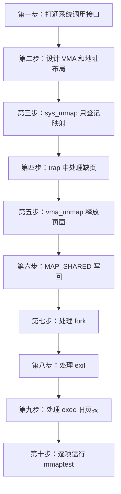
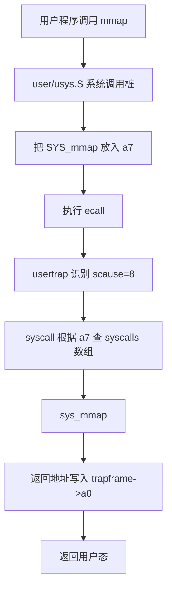
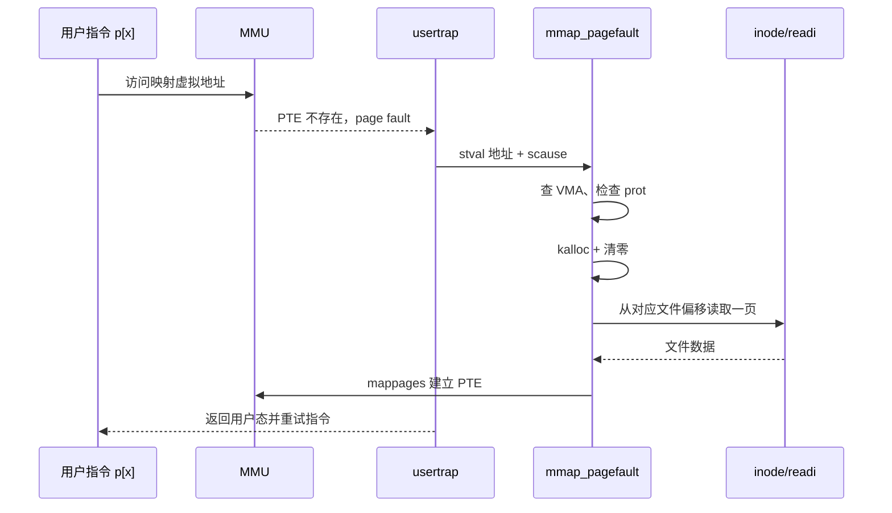
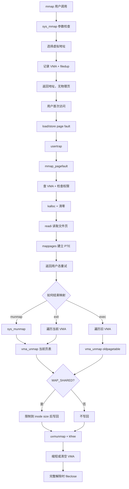

# xv6 mmap 实验完整解析

本文基于当前仓库中的 mmap 实现，按“用户调用 -> 系统调用 -> VMA 登记 -> 缺页加载 -> 解除映射 -> 进程生命周期”的顺序，完整解释 mmap 实验的设计、代码和执行流程。

## 0. 先建立实现思路

不要一开始就直接写 `sys_mmap()`。这个实验同时涉及系统调用、文件、页表、trap 和进程生命周期，先把问题拆开，才能知道每一步应该写什么函数、调用什么已有函数。

### 0.1 先从需求推出内核必须保存的信息

用户调用：

```c
mmap(addr, length, prot, flags, fd, offset);
```

调用返回后，用户可能马上关闭 fd，而且真正访问映射地址可能发生在很久以后。因此内核必须长期记住：

```text
哪一段虚拟地址属于映射？
它对应哪个文件？
对应文件的哪个偏移？
允许读还是允许写？
修改是否应该写回？
```

这说明只在 `sys_mmap()` 的局部变量里保存参数是不够的。系统调用返回后，局部变量就消失了。信息必须挂在长期存在的 `struct proc` 上，所以第一项设计是 VMA：

```c
struct vma {
  int valid;
  uint64 addr;
  uint64 length;
  int prot;
  int flags;
  uint64 offset;
  struct file *file;
};
```

推导关系是：

```text
mmap 返回后仍要保存映射信息
        ↓
映射属于某一个进程
        ↓
在 struct proc 中保存 VMA 数组
```

### 0.2 再决定何时分配物理内存

有两种可能：

```text
方案一：mmap 时立刻为全部区间分配页面并读取文件
方案二：mmap 时只记录 VMA，第一次访问时再加载对应页面
```

实验要求 lazy allocation，因此选择方案二。

这直接把实现拆成两个阶段：

1. `sys_mmap()`：只建立虚拟地址区间的描述，不分配物理页。
2. `mmap_pagefault()`：第一次访问时分配一页、读取文件、建立 PTE。

所以要牢牢记住：

```text
VMA 存在 != PTE 存在 != 物理页存在
```

刚执行完 mmap 时只有 VMA。第一次访问以后，该页才同时拥有 VMA、PTE 和物理页。

### 0.3 决定虚拟地址从哪里分配

普通进程内存从低地址向高地址增长：

```text
代码 -> 数据 -> 堆 -> 更高地址
```

因此 mmap 区适合从接近 `TRAPFRAME` 的高地址向低地址增长。为每个进程保存：

```c
uint64 mmap_top;
```

初始化：

```c
p->mmap_top = TRAPFRAME;
```

每次映射：

```c
size = PGROUNDUP(length);
start = p->mmap_top - size;
p->mmap_top = start;
```

同时必须检查 `start` 没有碰到 `PGROUNDUP(p->sz)`。

### 0.4 决定修改如何处理

根据 `flags` 分成两条路径：

```text
MAP_PRIVATE
    修改只留在当前进程物理页
    munmap 时直接释放，不写文件

MAP_SHARED
    修改最终要进入文件
    munmap/exit/exec 清理时调用 writei 写回
```

因此写回逻辑不属于 `sys_mmap()`，而属于解除映射函数 `vma_unmap()`。

### 0.5 决定哪些进程操作会影响映射

实现 mmap 不能只考虑 `mmap()` 和 `munmap()`。映射属于进程地址空间，因此至少还要审查：

| 进程操作 | mmap 需要做什么 |
| --- | --- |
| `fork()` | 子进程复制 VMA，并增加文件引用 |
| `exit()` | 写回共享页、释放物理页、关闭文件引用 |
| `exec()` | 清理旧程序的 VMA 和旧页表，再运行新程序 |
| `allocproc()` | 初始化空 VMA 数组和 `mmap_top` |
| `freeproc()` | 回收进程槽位时清除残留元数据 |

这一步很重要。若只让 `mmaptest` 的前几个基础测试通过，而没有处理 `exit/exec`，页表释放时很容易出现 `panic: freewalk: leaf`。

## 0.6 总体实现路线

从零实现时，推荐严格按下面顺序推进。



下面逐步说明每一步要编写的函数和要使用的已有函数。

## 0.7 第一步：打通 mmap 和 munmap 系统调用

### 需要修改的文件

```text
user/user.h
user/usys.pl
kernel/syscall.h
kernel/syscall.c
kernel/sysfile.c
```

### 需要声明的用户函数

在 `user/user.h` 中声明：

```c
void *mmap(void *, size_t, int, int, int, off_t);
int munmap(void *, size_t);
```

它们是给用户程序和编译器看的函数原型。这里声明的参数形式应与用户调用形式一致。

### 需要生成的系统调用桩

在 `user/usys.pl` 中加入：

```perl
entry("mmap");
entry("munmap");
```

脚本会生成类似以下逻辑的汇编桩：

```asm
li a7, SYS_mmap
ecall
ret
```

参数已经由 C 调用约定放在 `a0` 到 `a5`，桩函数只需设置系统调用编号并执行 `ecall`。

### 需要分配的系统调用编号

在 `kernel/syscall.h` 定义：

```c
#define SYS_mmap   22
#define SYS_munmap 23
```

编号必须唯一，因为内核使用 `a7` 中的编号选择处理函数。

### 需要注册的内核处理函数

在 `kernel/syscall.c`：

```c
extern uint64 sys_mmap(void);
extern uint64 sys_munmap(void);

[SYS_mmap]   sys_mmap,
[SYS_munmap] sys_munmap,
```

这里建立：

```text
系统调用编号 -> 内核函数地址
```

### 本阶段应编写的函数

先在 `kernel/sysfile.c` 提供可编译的函数框架：

```c
uint64 sys_mmap(void);
uint64 sys_munmap(void);
```

本阶段目标只是让用户调用能进入正确内核函数，不急着实现完整映射。

## 0.8 第二步：设计 VMA 和进程状态

### 需要编写的数据结构

在 `kernel/proc.h` 增加：

```c
#define NVMA 16
struct vma { ... };
```

并在 `struct proc` 增加：

```c
struct vma vmas[NVMA];
uint64 mmap_top;
```

### 需要修改的已有函数

`allocproc()` 中初始化：

```c
p->mmap_top = TRAPFRAME;
memset(p->vmas, 0, sizeof(p->vmas));
```

`freeproc()` 中清理进程槽位状态。

### 本阶段使用的已有定义和函数

| 名称 | 来源 | 用途 |
| --- | --- | --- |
| `TRAPFRAME` | `memlayout.h` | mmap 高地址分配上界 |
| `PGSIZE` | `riscv.h` | 页大小，4096 字节 |
| `PGROUNDUP(x)` | `riscv.h` | 把长度向上取整到页边界 |
| `memset()` | `string.c` | 清空 VMA 数组 |

## 0.9 第三步：编写 sys_mmap

### sys_mmap 的职责边界

它应该做：

```text
读取参数
验证参数
选择虚拟地址
寻找空 VMA
保存映射元数据
持有文件引用
返回映射地址
```

它不应该做：

```text
kalloc 物理页
readi 读取文件
mappages 建立 PTE
```

后面三项应留给 page fault，才能满足 lazy allocation。

### 本阶段编写的函数

```c
uint64
sys_mmap(void)
```

### 本阶段使用的已有函数

| 函数 | 参数 | 返回值 | 用途 |
| --- | --- | --- | --- |
| `myproc()` | 无 | 当前 `struct proc *` | 找到当前进程及其 VMA |
| `argaddr(n, &addr)` | 参数序号、保存位置 | void | 从 trapframe 取得地址参数 |
| `argint(n, &value)` | 参数序号、保存位置 | void | 从 trapframe 取得整数参数 |
| `argfd(n, &fd, &f)` | 参数序号、fd、file 指针 | 0/-1 | 验证 fd 并取得 `struct file *` |
| `filedup(f)` | 文件对象 | 同一个 file 指针 | 增加引用计数，使 close(fd) 后映射仍有效 |
| `PGROUNDUP(len)` | 字节数 | 页对齐长度 | 让 VMA 边界适合页表操作 |

### 本阶段的关键检查

1. `len > 0`。
2. 实验只支持 `addr == 0` 和 `offset == 0`。
3. `flags` 必须恰好是 `MAP_SHARED` 或 `MAP_PRIVATE`。
4. `prot` 只能包含允许的位。
5. 共享可写映射要求文件可写。
6. 映射地址不能与 `p->sz` 重叠。
7. 必须有空闲 VMA 槽位。

## 0.10 第四步：编写 mmap_pagefault

`sys_mmap()` 完成后，用户一访问返回地址就会 page fault。下一步是在 `kernel/trap.c` 中接住合法缺页。

### 需要修改的已有函数

修改 `usertrap()`，在系统调用和设备中断判断之后识别：

```c
r_scause() == 13  // load page fault
r_scause() == 15  // store page fault
```

### 本阶段编写的辅助函数

```c
static int
mmap_pagefault(struct proc *p, uint64 addr, uint64 cause)
```

参数：

- `p`：发生 fault 的进程。
- `addr`：`r_stval()` 返回的故障虚拟地址。
- `cause`：`r_scause()`，用于区分读 fault 和写 fault。

返回：

- `0`：成功补齐页面，可以返回用户态重试。
- `-1`：地址或权限非法，应终止进程。

### mmap_pagefault 的步骤

```text
1. PGROUNDDOWN(addr) 得到页面起始地址
2. 遍历 vmas[] 查找包含 addr 的 VMA
3. 根据 cause 和 prot 检查读写权限
4. kalloc() 分配物理页
5. memset() 清零整页
6. 计算文件偏移
7. ilock() 后调用 readi()
8. 根据 prot 构造 PTE 权限
9. mappages() 建立映射
10. 任一步失败时 kfree() 并返回 -1
```

### 本阶段使用的已有函数

| 函数 | 作用 |
| --- | --- |
| `r_scause()` | 读取 trap 原因 |
| `r_stval()` | 读取发生 fault 的虚拟地址 |
| `PGROUNDDOWN(addr)` | 得到虚拟页起点 |
| `kalloc()` | 分配一个物理页 |
| `kfree(mem)` | 失败时释放物理页 |
| `memset(mem, 0, PGSIZE)` | 清零，保证 EOF 后为 0 且不泄露旧数据 |
| `ilock(ip)` / `iunlock(ip)` | 读取 inode 前后加锁、解锁 |
| `readi(ip, user, dst, off, n)` | 从文件指定偏移读取数据 |
| `mappages(pt, va, size, pa, perm)` | 建立虚拟页到物理页的 PTE |
| `setkilled(p)` | fault 无法处理时标记进程退出 |

## 0.11 第五步：先编写不带写回的解除映射

先处理共同的页面释放逻辑，再加入共享写回，调试更容易。

### 本阶段编写的函数

在 `kernel/vm.c` 编写：

```c
int
vma_unmap(struct proc *p, pagetable_t pagetable,
          uint64 addr, uint64 len)
```

并在 `kernel/defs.h` 声明，供 `sysfile.c`、`proc.c` 和 `exec.c` 调用。

### 为什么传 p 和 pagetable 两个参数

```text
p          -> 提供 VMA、flags、offset、file
pagetable  -> 指定应该删除哪个地址空间中的 PTE
```

正常 `munmap/exit` 中两者属于同一个当前进程；`exec` 中 VMA 仍存放在 `p`，但要操作的是 `oldpagetable`。

### 本阶段使用的已有函数

| 函数/宏 | 用途 |
| --- | --- |
| `walk(pagetable, va, 0)` | 查询该虚拟页是否真的建立过 PTE |
| `PTE_V` | 判断 PTE 是否有效 |
| `uvmunmap(pagetable, va, 1, 1)` | 删除一个 PTE，并因 `do_free=1` 释放物理页 |
| `fileclose(v->file)` | 完整删除 VMA 时释放文件引用 |
| `memset(v, 0, sizeof(*v))` | 完整删除后回收 VMA 槽位 |

未发生过 page fault 的 VMA 页面没有 PTE，所以必须先 `walk()` 检查，不能直接对整段地址调用会因“not mapped”而 panic 的释放逻辑。

## 0.12 第六步：给 MAP_SHARED 加入写回

### 写回位置

写回必须发生在 `uvmunmap()` 之前，因为释放物理页以后就不能再读取用户修改的数据。

```text
walk 得到 PTE
    ↓
PTE2PA 得到物理页
    ↓
writei 写回文件
    ↓
uvmunmap 删除 PTE 并释放物理页
```

### 本阶段使用的已有函数

| 函数 | 作用 |
| --- | --- |
| `PTE2PA(*pte)` | 从 PTE 提取物理页地址 |
| `begin_op()` / `end_op()` | 包围一次文件系统日志事务 |
| `ilock()` / `iunlock()` | 保护 inode 内容和大小 |
| `writei(ip, 0, src, off, n)` | 从内核物理地址向文件写入 |

写回还需要处理两个边界：

1. 每次最多按 `BSIZE` 分块，避免日志事务过大。
2. 不允许写到 `ip->size` 之后，避免把不足整页的文件扩展到整页。

## 0.13 第七步：处理 fork

### 需要修改的已有函数

修改 `kernel/proc.c` 中的 `fork()`。

### 应执行的操作

```c
np->vmas[i] = p->vmas[i];
if(p->vmas[i].valid)
  np->vmas[i].file = filedup(p->vmas[i].file);
np->mmap_top = p->mmap_top;
```

这里使用 `filedup()`，因为父子进程之后可以独立 munmap 或 exit。

当前实现不复制 mmap 的现有物理页。子进程继承 VMA，访问时自己 page fault 并加载文件。这符合本实验测试要求。

## 0.14 第八步：处理 exit

### 需要修改的已有函数

修改 `kernel/proc.c` 中的 `exit()`，在关闭普通 fd 和释放页表之前遍历有效 VMA：

```c
vma_unmap(p, p->pagetable, v->addr, v->length);
```

复用同一个函数可以保证：

- 共享页面被写回。
- 已加载页面被释放。
- VMA 文件引用被关闭。

不要只 `memset(vmas)`，因为清零元数据不会释放任何资源。

## 0.15 第九步：处理 exec

### 需要修改的已有函数

修改 `kernel/exec.c` 中 `exec()` 成功提交新程序的路径。

### 正确顺序

```text
1. 新页表已经完整构建成功
2. oldpagetable = p->pagetable
3. p->pagetable = 新页表
4. 遍历旧 VMA
5. vma_unmap(p, oldpagetable, ...)
6. mmap_top 重置为 TRAPFRAME
7. proc_freepagetable(oldpagetable, oldsz)
```

必须传 `oldpagetable`，因为切换后 `p->pagetable` 已是新程序页表。

也不能在 exec 加载失败的 `bad:` 路径清理旧 VMA；加载失败时旧程序仍需要继续运行。

## 0.16 第十步：按功能阶段测试

不要一次写完所有代码后才运行测试。建议按下面顺序判断问题属于哪个阶段：

| 现象 | 优先检查 |
| --- | --- |
| 用户程序提示 exec mmaptest failed | 用户程序是否加入 Makefile，系统调用接口是否完整 |
| mmap 直接返回 -1 | `sys_mmap()` 参数检查、VMA 槽位、地址重叠 |
| 第一次读映射就被杀死 | `usertrap()`、VMA 查找、`readi()`、PTE_R |
| 写只读映射没有失败 | page fault 权限检查和 PTE_W |
| close(fd) 后映射失效 | `filedup()` 是否存在 |
| MAP_PRIVATE 修改了文件 | `vma_unmap()` 不应写回 private |
| dirty read #2 失败 | 写回是否越过 `inode->size` |
| 部分 munmap 后剩余地址失效 | VMA 的 addr/length/offset 更新 |
| fork 后子进程 fault | 子 VMA 和 filedup 是否复制 |
| exit/exec 出现 freewalk: leaf | mmap PTE 是否在释放页表前解除 |

## 0.17 要编写和修改的函数总表

| 函数/数据结构 | 类型 | 所在文件 | mmap 中的职责 |
| --- | --- | --- | --- |
| `struct vma` | 新数据结构 | `kernel/proc.h` | 保存一段映射的长期状态 |
| `struct proc.vmas` | 新字段 | `kernel/proc.h` | 保存进程所有 VMA |
| `struct proc.mmap_top` | 新字段 | `kernel/proc.h` | 从高向低分配 mmap 地址 |
| `sys_mmap()` | 新函数 | `kernel/sysfile.c` | 参数验证并创建 VMA |
| `sys_munmap()` | 新函数 | `kernel/sysfile.c` | 取得参数并调用统一解除函数 |
| `mmap_pagefault()` | 新辅助函数 | `kernel/trap.c` | 按需加载一页文件内容 |
| `vma_unmap()` | 新公共函数 | `kernel/vm.c` | 写回、解除 PTE、释放页面、更新 VMA |
| `usertrap()` | 修改已有函数 | `kernel/trap.c` | 把 load/store page fault 交给 mmap 处理 |
| `allocproc()` | 修改已有函数 | `kernel/proc.c` | 初始化 mmap 状态 |
| `freeproc()` | 修改已有函数 | `kernel/proc.c` | 清理复用的进程槽位状态 |
| `fork()` | 修改已有函数 | `kernel/proc.c` | 复制 VMA 和文件引用 |
| `exit()` | 修改已有函数 | `kernel/proc.c` | 退出前清理所有映射 |
| `exec()` | 修改已有函数 | `kernel/exec.c` | 清理旧 VMA 和 oldpagetable |

## 0.18 会使用到的 xv6 已有函数总表

| 已有函数 | 模块 | 在 mmap 中的用途 |
| --- | --- | --- |
| `myproc()` | 进程 | 取得当前进程 |
| `argaddr()` | 系统调用 | 取得地址参数 |
| `argint()` | 系统调用 | 取得整数参数 |
| `argfd()` | 文件系统调用 | 验证 fd 并取得 file |
| `filedup()` | 文件 | 增加映射持有的文件引用 |
| `fileclose()` | 文件 | VMA 完全消失时释放文件引用 |
| `kalloc()` | 物理内存 | fault 时分配一页 |
| `kfree()` | 物理内存 | 失败或解除映射时释放页面 |
| `readi()` | inode | 把文件内容读入新页 |
| `writei()` | inode | 把共享映射修改写回文件 |
| `ilock()/iunlock()` | inode | 保护 inode 读写 |
| `begin_op()/end_op()` | 日志 | 保护文件写回事务 |
| `walk()` | 虚拟内存 | 查找某虚拟地址的 PTE |
| `mappages()` | 虚拟内存 | 建立 VA 到 PA 的映射 |
| `uvmunmap()` | 虚拟内存 | 删除 PTE 并按需释放物理页 |
| `PTE2PA()` | 页表宏 | 从 PTE 得到物理地址 |
| `PGROUNDUP()` | 页表宏 | 长度向上页对齐 |
| `PGROUNDDOWN()` | 页表宏 | fault 地址向下页对齐 |
| `r_scause()` | RISC-V CSR | 判断 trap 类型 |
| `r_stval()` | RISC-V CSR | 获得故障虚拟地址 |
| `setkilled()` | 进程 | 非法 fault 时终止进程 |
| `proc_freepagetable()` | 进程/页表 | VMA 清理后释放剩余页表 |

## 1. mmap 要解决什么问题

普通文件访问使用 `read()` 和 `write()`：

```text
用户缓冲区 <-> read/write 系统调用 <-> 文件
```

`mmap()` 的目标是把文件的一段内容放进进程的虚拟地址空间，使程序可以像访问普通内存一样访问文件：

```c
char *p = mmap(0, 8192, PROT_READ, MAP_PRIVATE, fd, 0);
char c = p[100];
```

这里没有显式调用 `read()`，但 `p[100]` 最终仍会得到文件偏移 100 处的内容。

核心关系是：

```text
用户虚拟地址 = VMA 起始地址 + 页内位置
文件偏移     = VMA 文件偏移 + (用户虚拟地址 - VMA 起始地址)
```

本实验采用 lazy allocation（延迟分配）：

1. `mmap()` 只选择虚拟地址并记录映射关系。
2. 此时没有分配物理页，也没有读取文件。
3. 用户第一次访问映射地址时发生 page fault。
4. 内核在 page fault 中分配物理页，从文件读取数据并建立 PTE。
5. 指令返回用户态后重新执行，这次访问成功。

这种设计避免为从未访问过的映射页面分配内存和执行磁盘读取。

## 2. 本实验支持的接口

用户态声明位于 `user/user.h`：

```c
void *mmap(void *addr, size_t length, int prot,
           int flags, int fd, off_t offset);
int munmap(void *addr, size_t length);
```

### 2.1 mmap 参数

| 参数 | 含义 | 当前实验限制 |
| --- | --- | --- |
| `addr` | 用户建议的映射起始地址 | 只接受 0，由内核选择地址 |
| `length` | 需要映射的字节数 | 必须大于 0，内部按页向上取整 |
| `prot` | 映射页面的访问权限 | 支持 `PROT_READ`、`PROT_WRITE` 及其组合 |
| `flags` | 映射类型 | 必须是 `MAP_SHARED` 或 `MAP_PRIVATE` |
| `fd` | 被映射文件的描述符 | 必须对应 inode 文件 |
| `offset` | 映射从文件哪个偏移开始 | 当前实验只接受 0 |

成功时返回映射起始虚拟地址，失败时返回 `(void *)-1`。

### 2.2 prot

定义位于 `kernel/fcntl.h`：

```c
#define PROT_NONE  0x0
#define PROT_READ  0x1
#define PROT_WRITE 0x2
#define PROT_EXEC  0x4
```

当前实现不接受 `PROT_NONE` 和 `PROT_EXEC`，只处理读、写权限。

`prot` 最终会转换成 RISC-V PTE 权限：

```text
PROT_READ              -> PTE_U | PTE_R
PROT_READ|PROT_WRITE   -> PTE_U | PTE_R | PTE_W
```

`PTE_U` 表示用户态允许访问该页。

### 2.3 flags

```c
#define MAP_SHARED  0x01
#define MAP_PRIVATE 0x02
```

- `MAP_SHARED`：解除映射或退出时，把内存修改写回文件。
- `MAP_PRIVATE`：修改只影响当前进程的物理页，不写回文件。

当前实验并没有让多个进程真正共享同一个物理页。fork 后父子进程可以分别发生缺页并读取各自的物理页；实验重点是文件写回语义，而不是完整 POSIX 共享页缓存。

## 3. 系统调用链路

一次用户态 `mmap()` 的调用链如下：



需要修改或关联的文件是：

1. `user/user.h`：向用户程序声明 `mmap()`、`munmap()`。
2. `user/usys.pl`：生成执行 `ecall` 的用户态汇编桩。
3. `kernel/syscall.h`：分配 `SYS_mmap` 和 `SYS_munmap` 编号。
4. `kernel/syscall.c`：把系统调用编号映射到内核处理函数。
5. `kernel/sysfile.c`：实现 `sys_mmap()` 和 `sys_munmap()`。

用户传入的前六个参数按照 RISC-V ABI 位于 `a0` 到 `a5`。进入内核后，`argaddr()`、`argint()` 和 `argfd()` 从当前进程的 trapframe 中取得它们。

## 4. VMA 数据结构

VMA 是 Virtual Memory Area，即一段具有相同映射属性的连续虚拟地址区间。

当前定义位于 `kernel/proc.h`：

```c
#define NVMA 16

struct vma {
  int valid;
  uint64 addr;
  uint64 length;
  int prot;
  int flags;
  uint64 offset;
  struct file *file;
};
```

各字段作用如下：

| 字段 | 作用 |
| --- | --- |
| `valid` | 该数组槽位是否正在使用 |
| `addr` | 映射区间的起始虚拟地址，按页对齐 |
| `length` | 映射区间长度，当前实现保存向上取整后的页长度 |
| `prot` | 用户请求的读写权限 |
| `flags` | `MAP_SHARED` 或 `MAP_PRIVATE` |
| `offset` | `addr` 对应的文件起始偏移 |
| `file` | 映射持有的文件对象引用 |

每个进程有：

```c
struct vma vmas[NVMA];
uint64 mmap_top;
```

因此每个进程最多同时保存 16 个 VMA。

`mmap_top` 是下一次 mmap 分配地址时使用的上边界。初始值是 `TRAPFRAME`，映射区从高地址向低地址增长，而普通堆由低地址向高地址增长：

```text
低地址
0          程序代码、数据、堆
           堆向上增长
           ... 未使用空间 ...
           mmap 区向下增长
mmap_top   下一次 mmap 的上边界
TRAPFRAME  trapframe
TRAMPOLINE trampoline
高地址
```

这种布局让普通 `sbrk()` 内存和 mmap 区域从两端增长，降低重叠概率。

## 5. sys_mmap 从头到尾

实现位于 `kernel/sysfile.c`。

### 5.1 取得参数

```c
argaddr(0, &addr);
argint(1, &len);
argint(2, &prot);
argint(3, &flags);
argfd(4, &fd, &f);
argint(5, &off);
```

- `argaddr(n, &x)` 取得第 n 个地址参数。
- `argint(n, &x)` 取得第 n 个整数参数。
- `argfd(n, &fd, &f)` 不仅取得 fd，还检查 fd 是否有效，并返回对应 `struct file *`。

`sys_mmap()` 本身没有参数，是因为 xv6 的所有内核系统调用处理函数统一使用 `uint64 func(void)` 形式。用户参数统一从 trapframe 中读取。

### 5.2 参数检查

当前实现依次检查：

```text
length > 0
addr == 0
offset == 0
fd 有效
共享可写映射要求文件本身可写
读映射要求文件可读
flags 只能二选一
prot 只能包含 READ/WRITE 且不能为 0
文件必须是 FD_INODE
地址空间足够
存在空闲 VMA 槽位
```

共享可写映射必须要求文件可写：

```c
if((prot & PROT_WRITE) &&
   (flags & MAP_SHARED) &&
   !f->writable)
  return -1;
```

原因是 `MAP_SHARED` 的修改需要写回文件。若文件以只读方式打开，允许这种映射就绕过了文件写权限。

但“只读文件 + `MAP_PRIVATE | PROT_WRITE`”是允许的，因为修改不会写回原文件。

### 5.3 选择地址

```c
uint64 size = PGROUNDUP(len);
uint64 start = p->mmap_top - size;
```

页表以页为单位建立映射，所以长度必须向上取整。例如：

```text
用户请求 5000 字节
PGSIZE = 4096
实际 VMA 长度 = 8192 字节
```

随后检查普通用户内存是否会与 mmap 区重叠：

```c
if(PGROUNDUP(p->sz) >= start)
  return -1;
```

### 5.4 建立 VMA，而不是建立 PTE

找到空闲槽位后记录：

```c
v->addr = start;
v->length = size;
v->prot = prot;
v->flags = flags;
v->offset = off;
v->file = filedup(f);
v->valid = 1;
p->mmap_top = start;
```

这里没有调用 `kalloc()`、`readi()` 或 `mappages()`。所以 mmap 返回时，映射地址还没有对应物理页。

### 5.5 为什么必须 filedup

用户可以在 mmap 后立即 `close(fd)`：

```c
char *p = mmap(..., fd, ...);
close(fd);
printf("%c\n", p[0]);
```

映射仍应有效。为此 VMA 必须独立持有一次文件引用：

```c
v->file = filedup(f);
```

文件描述符表中的引用和 VMA 中的引用彼此独立：

```text
open(fd)       文件引用计数 +1
mmap/filedup   文件引用计数 +1
close(fd)      文件引用计数 -1，但 VMA 仍持有引用
munmap         VMA 的 fileclose 使引用计数 -1
```

这也解释了为什么文件被 `unlink()` 后，已有映射仍然可以读取：inode 目录项虽然删除了，但 VMA 的文件引用还没有释放。

## 6. 第一次访问：page fault

假设 mmap 返回 `0x3fffffc000`，但页表里没有该地址的有效 PTE。当用户执行：

```c
char c = p[10];
```

RISC-V MMU 查页表失败，进入 trap。

### 6.1 scause 和 stval

`usertrap()` 读取：

- `scause == 13`：load page fault，读取地址时缺页。
- `scause == 15`：store/AMO page fault，写入地址时缺页或无写权限。
- `stval`：发生错误的虚拟地址。

当前入口是：

```c
if(r_scause() == 13 || r_scause() == 15){
  if(mmap_pagefault(p, r_stval(), r_scause()) < 0)
    setkilled(p);
}
```

若无法合法处理 fault，进程会被标记 killed，随后 `exit(-1)`。

### 6.2 查找所属 VMA

`mmap_pagefault()` 遍历当前进程的 VMA：

```c
addr >= v->addr && addr - v->addr < v->length
```

使用减法形式检查右边界，可以清楚表示：

```text
v->addr <= addr < v->addr + v->length
```

如果找不到 VMA，说明访问的不是合法 mmap 区间，不能分配页面。

### 6.3 检查访问权限

```c
if(cause == 13 && !(v->prot & PROT_READ))
  return -1;
if(cause == 15 && !(v->prot & PROT_WRITE))
  return -1;
```

这一步阻止：

- 从不可读映射读取。
- 向只读映射写入。

后面建立 PTE 时还会再次通过 `PTE_R/PTE_W` 固化权限。软件检查决定当前 fault 是否允许处理，PTE 权限则让硬件持续执行保护。

### 6.4 分配并清零物理页

```c
char *mem = kalloc();
memset(mem, 0, PGSIZE);
```

必须先清零。若文件不足一页，`readi()` 只覆盖文件实际存在的部分，剩余区域应读出 0；同时清零还能避免泄露该物理页之前保存的内核或其他进程数据。

### 6.5 计算文件偏移

先把 fault 地址向下对齐：

```c
uint64 va = PGROUNDDOWN(addr);
```

再计算该页对应的文件位置：

```c
uint64 offset = v->offset + va - v->addr;
```

例子：

```text
VMA.addr   = 0x40000000
VMA.offset = 0
fault addr = 0x40001234
va         = 0x40001000
文件偏移   = 0 + 0x1000 = 4096
```

也就是说，应把文件第二页读入该物理页。

### 6.6 从 inode 读取

```c
ilock(ip);
int n = readi(ip, 0, (uint64)mem, offset, PGSIZE);
iunlock(ip);
```

`readi()` 参数含义：

| 参数 | 含义 |
| --- | --- |
| `ip` | 目标 inode |
| `user_dst=0` | 目标地址是内核地址，不使用 copyout |
| `dst=mem` | 新分配物理页的内核可访问地址 |
| `off=offset` | 文件读取起点 |
| `n=PGSIZE` | 最多读取一页 |

如果到达 EOF，`readi()` 可以少读。因为页面预先清零，EOF 后面的内存自然保持为 0。

### 6.7 建立 PTE

根据 `prot` 生成权限后调用：

```c
mappages(p->pagetable, va, PGSIZE, (uint64)mem, perm);
```

它把用户虚拟页 `va` 映射到物理页 `mem`。返回用户态后，造成 fault 的指令会重新执行；这一次 MMU 能找到有效 PTE，因此访问成功。

完整 fault 流程：



## 7. munmap 与 vma_unmap

`sys_munmap()` 只负责取得参数，然后调用公共逻辑：

```c
vma_unmap(p, p->pagetable, addr, len);
```

当前函数声明为：

```c
int vma_unmap(struct proc *p, pagetable_t pagetable,
              uint64 addr, uint64 len);
```

参数含义：

| 参数 | 作用 |
| --- | --- |
| `p` | 提供 VMA 数组和文件引用 |
| `pagetable` | 明确指定应解除哪个页表中的映射 |
| `addr` | 解除映射的起始虚拟地址 |
| `len` | 解除映射的字节数 |

显式传入页表非常重要：普通 `munmap()` 和 `exit()` 操作当前页表，而 `exec()` 必须清理旧页表 `oldpagetable`。

### 7.1 参数与范围检查

函数首先要求：

```text
len > 0
addr 页对齐
addr + len 不发生整数溢出
整个解除区间包含在某一个 VMA 中
```

实验允许从 VMA 头部或尾部解除，不允许从中间挖洞：

```text
原 VMA: [A----------------B)

允许头部解除: [A----X)  剩余 [X--------B)
允许尾部解除: [X----B)  剩余 [A--------X)
允许全部解除: [A----------------B)
不允许中间洞: [A---X      Y----B)
```

若允许中间挖洞，一个 VMA 会分裂成两个 VMA，需要额外寻找空槽、复制文件引用和维护两个 offset。本实验不要求这种情况。

### 7.2 MAP_SHARED 写回

只有 `MAP_SHARED` 执行写回。每个已实际映射的页面：

1. `walk(pagetable, va, 0)` 查 PTE。
2. PTE 不存在或无 `PTE_V`，说明该页从未被访问，直接跳过。
3. `PTE2PA(*pte)` 得到物理地址。
4. 计算该页对应的文件偏移。
5. 使用 `writei()` 分块写回。
6. 调用 `uvmunmap()` 删除 PTE 并释放物理页。

为什么按 `BSIZE` 分块：xv6 日志一次事务能容纳的磁盘块数量有限。把整页作为一次复杂文件系统事务可能超过日志容量。当前代码对每个块分别执行：

```c
begin_op();
ilock(ip);
writei(...);
iunlock(ip);
end_op();
```

### 7.3 为什么写回不能超过 inode->size

测试文件长度是 1.5 页，而映射长度可能是 2 页或 3 页：

```text
第一页：4096 字节有效文件数据
第二页：前 2048 字节有效，后 2048 字节是映射中的零
第三页：完全位于 EOF 之后
```

如果第二页直接写回完整 `PGSIZE`，`writei()` 会把文件从 6144 字节扩展到 8192 字节。这不符合测试预期。

所以当前实现计算：

```c
uint64 fileoff = off + written;
if(fileoff >= ip->size)
  break;
if(chunk > ip->size - fileoff)
  chunk = ip->size - fileoff;
```

这样只覆盖文件原有范围，不因为 mmap 写回而扩展文件。

### 7.4 为什么还要第二轮 unmap

第一轮只在 `MAP_SHARED` 分支内执行写回和解除。后面的通用循环处理：

- `MAP_PRIVATE` 的页面；
- 未在前一轮处理到的有效页面。

已经在第一轮解除的共享页面，其 PTE 已无效，第二轮会跳过，因此不会重复释放。

### 7.5 更新 VMA 的三种情况

完整解除：

```c
fileclose(v->file);
memset(v, 0, sizeof(*v));
```

此时映射完全消失，VMA 持有的文件引用必须释放，槽位也应恢复为空闲。

解除头部：

```c
v->addr = end;
v->length = vend - end;
v->offset += len;
```

`offset` 必须同步增加。例如原来 `addr` 对应文件偏移 0，删除第一页后，新 `addr` 应对应文件偏移 4096。

解除尾部：

```c
v->length = addr - v->addr;
```

起点和文件偏移没有变化，只缩短长度。

部分解除时不能 `fileclose()` 或清空 VMA，因为剩余区间仍然依赖该文件对象处理后续 page fault 和写回。

## 8. fork 如何处理 mmap

`fork()` 中先执行：

```c
uvmcopy(p->pagetable, np->pagetable, p->sz);
```

这只复制普通用户内存 `[0, p->sz)`。mmap 区位于高地址，不在 `p->sz` 内，因此已加载的 mmap 物理页不会通过这一步复制。

随后复制 VMA 元数据：

```c
np->vmas[i] = p->vmas[i];
if(p->vmas[i].valid)
  np->vmas[i].file = filedup(p->vmas[i].file);
np->mmap_top = p->mmap_top;
```

子进程第一次访问映射地址时会自己发生 page fault，再从文件加载自己的物理页。

必须 `filedup()`，不能只复制指针。否则父子进程都以为自己持有文件引用：一个进程解除映射并 `fileclose()` 后，另一个进程可能持有已经释放的 `struct file *`。

本实验中的 fork 结果可以概括为：

```text
父进程 VMA ----file 引用----> inode
子进程 VMA ----file 引用----> 同一 inode

父子页表中的 mmap 物理页通常彼此独立，按需加载。
```

## 9. exit 如何处理 mmap

进程退出时，用户不会再主动调用 `munmap()`，所以内核必须代为清理：

```c
for each valid VMA:
    vma_unmap(p, p->pagetable, v->addr, v->length)
```

这一步完成三件事：

1. `MAP_SHARED` 的已加载页面写回文件。
2. 删除 mmap PTE 并释放物理页。
3. 关闭 VMA 持有的文件引用。

必须在 `proc_freepagetable()` 前完成。否则页表中还留有 mmap 叶子 PTE，递归释放页表的 `freewalk()` 会遇到未清理叶子并 panic：

```text
panic: freewalk: leaf
```

普通 `ofile[]` 文件描述符在后面单独关闭。VMA 引用与 fd 引用是两组引用，所以两边都需要正确释放。

## 10. exec 如何处理 mmap

`exec()` 不创建新进程，而是在同一个 `struct proc` 中用新程序替换旧地址空间。

成功加载新 ELF 后会有两个页表：

```text
oldpagetable：旧程序及旧 mmap 页面
pagetable：新程序代码、数据和栈
```

当前实现先保存并切换：

```c
oldpagetable = p->pagetable;
p->pagetable = pagetable;
p->sz = sz;
```

然后遍历旧 VMA，但显式把 `oldpagetable` 传给 `vma_unmap()`：

```c
vma_unmap(p, oldpagetable, v->addr, v->length);
```

如果 `vma_unmap()` 内部写死使用 `p->pagetable`，此时它会错误操作新程序页表。因此显式页表参数建立了清晰的所有权：VMA 信息来自 `p`，需要解除的 PTE 来自指定的 `pagetable`。

清理完旧 VMA 后：

```c
p->mmap_top = TRAPFRAME;
proc_freepagetable(oldpagetable, oldsz);
```

只有 exec 成功提交新程序时才能清理旧 VMA。若加载 ELF 失败，旧程序还要继续运行，不能破坏旧地址空间。

## 11. allocproc 与 freeproc

分配进程时初始化：

```c
p->mmap_top = TRAPFRAME;
memset(p->vmas, 0, sizeof(p->vmas));
```

这保证新进程没有残留 VMA。

`freeproc()` 再次清零这些字段，是为了进程槽位回收到 `UNUSED` 后，下次复用时状态干净。

正常退出路径应已经在 `exit()` 中完成文件写回和引用释放。单纯 `memset(vmas)` 只能清元数据，不能替代 `vma_unmap()`，因为它不会释放物理页、写回文件或减少文件引用计数。

## 12. 一个完整例子

用户程序：

```c
int fd = open("data", O_RDWR);
char *p = mmap(0, 6000, PROT_READ | PROT_WRITE,
               MAP_SHARED, fd, 0);
close(fd);
char x = p[100];
p[5000] = 'X';
munmap(p, 6000);
```

执行过程：

### 第一步：open

`open()` 在 `p->ofile[]` 中建立 fd，指向一个 `struct file`，该 file 再指向 data 文件的 inode。

### 第二步：mmap 系统调用

`sys_mmap()`：

1. 验证 fd、权限、flags。
2. 把 6000 向上取整为 8192。
3. 从 `mmap_top` 向下选择 8192 字节虚拟地址。
4. 建立 VMA。
5. `filedup()` 增加文件引用。
6. 返回起始地址 p。

此时两个虚拟页都没有物理页。

### 第三步：close(fd)

fd 引用被释放，但 VMA 的独立引用仍在，因此映射继续有效。

### 第四步：读取 p[100]

第一页不存在 PTE，产生 load page fault：

1. `stval = p + 100`。
2. 找到 VMA。
3. 检查允许读。
4. 分配并清零第一页。
5. 从文件偏移 0 读取最多 4096 字节。
6. 建立可读可写 PTE。
7. 返回用户态重试读取。

### 第五步：写入 p[5000]

5000 位于第二页，第二页尚未加载，产生 store page fault：

1. 找到同一个 VMA。
2. 检查 `PROT_WRITE`。
3. 分配第二个物理页。
4. 从文件偏移 4096 读取数据。
5. 建立可写 PTE。
6. 重试指令，把 `'X'` 写入第二页页内偏移 904。

对应文件位置是：

```text
VMA.offset + (5000 - 0) = 文件偏移 5000
```

### 第六步：munmap

因为是 `MAP_SHARED`：

1. 查找第一页 PTE并写回文件偏移 0。
2. 查找第二页 PTE并写回文件偏移 4096。
3. 写回长度不超过 inode 原长度。
4. 删除两个 PTE并释放两个物理页。
5. 完整 VMA 已删除，执行 `fileclose()`。
6. 清空 VMA 槽位。

## 13. mmaptest 每项在验证什么

| 测试 | 验证内容 |
| --- | --- |
| basic mmap | 文件内容能通过映射读取，EOF 后页面内容为 0 |
| mmap private | 私有可写映射不会修改文件 |
| mmap read-only | 只读 fd 不能建立共享可写映射 |
| mmap read/write | 可读写文件可以建立共享可写映射，close(fd) 后仍有效 |
| mmap dirty | 共享修改写回，且不能把 1.5 页文件扩成 2 页 |
| not-mapped unmap | 部分解除后可继续解除剩余 VMA |
| lazy access | mmap 时不预读文件，第一次访问才读取最新内容 |
| mmap two files | 多个 VMA 能同时独立工作 |
| fork | 子进程继承 VMA 和文件引用，父子清理互不破坏 |
| munmap prevents access | 解除 PTE 后再次访问会失败 |
| writes to read-only | PTE 和 fault 逻辑阻止写只读映射 |

## 14. 常见错误及原因

### 14.1 mmap 时立即分配并读取所有页面

这样可能功能上可读，但无法通过 lazy access 语义，也浪费内存和 I/O。

### 14.2 没有 filedup

用户 `close(fd)` 后，VMA 中的文件指针可能失效，page fault 或 munmap 时会访问已释放对象。

### 14.3 page fault 不检查 VMA

任意非法地址都可能被内核分配成合法页，破坏内存保护。

### 14.4 PTE 权限总是设为可写

`PROT_READ` 映射也能被写入，read-only 测试失败。

### 14.5 MAP_PRIVATE 也写回

私有修改污染原文件。

### 14.6 MAP_SHARED 写回整页到 EOF 之后

文件被意外扩展，`dirty read #2` 预期半页却读到整页。

### 14.7 部分 munmap 后清空整个 VMA

剩余映射失去元数据，后续访问无法处理 page fault，文件引用也可能提前释放。

### 14.8 完整 munmap 重复 fileclose

第一次清空 VMA 后 `v->file` 变为 0，再执行 `fileclose(v->file)` 会造成空指针访问和 kerneltrap。

### 14.9 exit/exec 直接 freewalk

mmap 页位于 `p->sz` 以上，普通页表释放路径不会按 `p->sz` 删除它们，最终出现 `panic: freewalk: leaf`。

### 14.10 exec 清理 p->pagetable

切换新页表后，`p->pagetable` 已指向新程序。旧 VMA 必须作用于 `oldpagetable`，否则会破坏新地址空间并遗留旧页表叶子。

## 15. 推荐的实现顺序

如果从头独立完成该实验，可以按以下顺序推进：

1. 先打通 `mmap/munmap` 系统调用编号、声明和空处理函数。
2. 在 `proc.h` 中设计 VMA，并在进程分配时初始化。
3. 实现 `sys_mmap()` 参数验证和 VMA 登记，但暂不处理 page fault。
4. 画出普通内存与 mmap 区地址布局，完成地址分配和重叠检查。
5. 在 `usertrap()` 中识别 load/store page fault。
6. 实现 VMA 查找、物理页分配、文件读取和 PTE 权限。
7. 先实现 `MAP_PRIVATE` 的解除映射。
8. 再实现 `MAP_SHARED` 分块写回和 EOF 边界。
9. 处理 VMA 头部、尾部和完整解除三种形态。
10. 为 fork 复制 VMA 并增加文件引用。
11. 在 exit 中清理所有 VMA。
12. 在 exec 中显式清理 oldpagetable。
13. 逐项运行 `mmaptest`，根据第一个失败项定位对应阶段。

## 16. 最终调用总图



## 17. 一句话抓住核心

这个实验的核心不是“把文件一次性复制到内存”，而是维护一份 VMA 契约：某段虚拟地址对应某个文件区间、具有什么权限、修改是否需要写回。`mmap()` 创建契约，page fault 按需兑现契约，`munmap/exit/exec` 结束契约并完成写回、释放页面和关闭文件引用。
