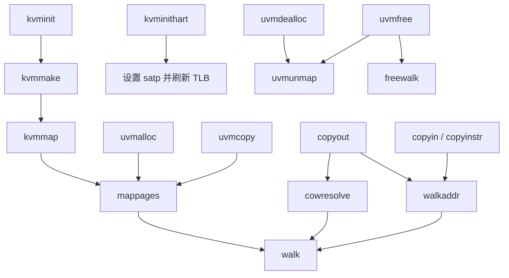
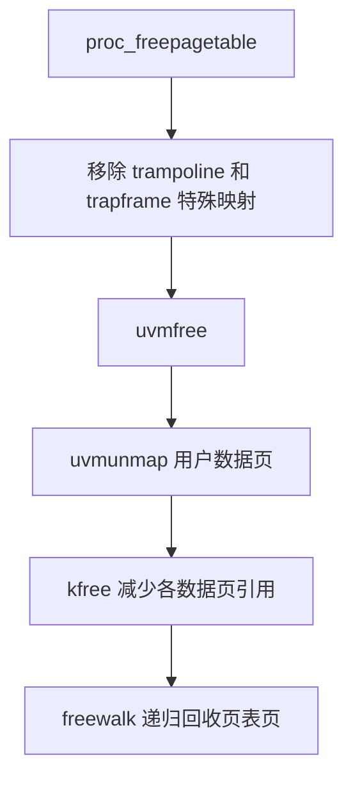

# xv6 vm.c 函数阅读笔记

本文按当前 COW 分支的 `kernel/vm.c` 整理全部 20 个函数，说明职责、参数、返回值和相互关系。函数前的注释是阅读说明，不修改源代码。当前版本处理普通 4 KiB 页面，不包含之前超级页实验的特殊处理。

## 一、阅读前需要分清的对象

| 对象 | 含义 |
|---|---|
| `va` | 虚拟地址，要结合指定页表才能翻译 |
| `pa` | 物理地址 |
| `pagetable_t` | 页表页指针；每个页表页包含 512 个 PTE |
| `pte_t` | 一个 64 位页表项的内容 |
| `pte_t *pte` | 指向页表项的指针，修改 `*pte` 就是在修改页表 |
| 页表页 | 存放 PTE 的物理页 |
| 数据页 | 存放程序代码、栈、堆等内容的物理页 |

内核直接映射物理 RAM，因此这里可将 `kalloc()` 返回的地址作为内核指针访问，也可作为建立映射时的物理地址使用。这是 xv6 的地址布局约定，不是所有操作系统都能这样做。

关键宏：

```c
PTE2PA(*pte)       // 从编码后的 PTE 中取出物理页基址
PA2PTE(pa)         // 把物理页地址转换为 PTE 的地址字段
PTE_FLAGS(*pte)    // 取出权限及软件标志
PGROUNDDOWN(va)   // 向下对齐到所在页的起始地址
PGROUNDUP(sz)     // 向上对齐到页边界
```

不要把 `PTE2PA(*pte)` 当成带页内偏移的完整地址；完整物理地址通常是“物理页基址 + 页内偏移”。

## 二、整体调用关系



可以先学习 `walk()`、`mappages()`、`walkaddr()`，再阅读分配与释放，最后看 COW 和跨地址空间复制。

## 三、内核页表初始化

### 1. kvmmake：构建内核页表

```c
// 创建内核根页表，添加设备、内核内存和特殊映射。
pagetable_t kvmmake(void);
```

无参数，返回新建的根页表指针。它先分配并清零一个页表页，然后通过 `kvmmap()` 建立：

- UART、VirtIO、PLIC 的设备地址映射。
- 内核代码映射：可读、可执行，不可写。
- 内核数据和其余物理 RAM 映射：可读、可写。
- `TRAMPOLINE` 的高地址映射。
- `proc_mapstacks()` 创建的各进程内核栈映射。

设备和 RAM 的大部分映射满足 VA 等于 PA，但 trampoline、内核栈等映射不能笼统理解成恒等映射。此函数只构建页表，不切换 CPU 当前使用的页表。当前实现也没有为最初的 `kalloc()` 提供返回 0 的处理分支。

### 2. kvminit：保存全局内核页表

```c
// 建立内核页表，并保存到全局 kernel_pagetable。
void kvminit(void);
```

核心就是 `kernel_pagetable = kvmmake()`。无返回值，负责创建共享的内核页表对象。

### 3. kvminithart：让当前 CPU 使用内核页表

```c
// 为当前 hart 设置 satp，使内核页表生效。
void kvminithart(void);
```

hart 可以先理解为一个硬件执行核心。此函数在写 `satp` 前后执行 `sfence_vma()`，使页表写入和地址转换缓存满足切换要求。

区别是：`kvminit()` 创建表，`kvminithart()` 让当前 CPU 使用这张表。

### 4. kvmmap：启动时建立内核映射

```c
// 在 kpgtbl 中把 va 开始的 sz 字节映射到 pa。
void kvmmap(pagetable_t kpgtbl, uint64 va,
            uint64 pa, uint64 sz, int perm);
```

`kpgtbl` 是目标内核页表；`va`、`pa` 是起始地址；`sz` 是字节数；`perm` 是权限组合。内部调用 `mappages()`，失败就 panic。它不启用分页，也不主动刷新 TLB。

## 四、查询和建立映射

### 5. walk：找到虚拟地址对应的 PTE

```c
// 查找最终一级 PTE 的地址；alloc 非零时可补建中间页表页。
pte_t *walk(pagetable_t pagetable, uint64 va, int alloc);
```

| 参数 | 含义 |
|---|---|
| `pagetable` | 根页表指针 |
| `va` | 要查询的虚拟地址，不必页对齐 |
| `alloc` | 0 表示只查询；非零表示允许分配缺失的中间页表页 |

Sv39 的索引关系为：

```text
根页表 -- VA[38:30] --> 一级页表
一级页表 -- VA[29:21] --> 零级页表
零级页表 -- VA[20:12] --> 最终 PTE
VA[11:0] 是页内偏移
```

当前 xv6 使用低地址部分，要求 `va < MAXVA`，否则 panic。查询缺少中间层且不允许分配，或者分配失败时，返回 0。

**返回非零不代表最终映射有效**：即使最终 `*pte` 为 0，只要中间层存在，也能返回这个空 PTE 的地址。调用方还需检查 `PTE_V`。

`alloc=1` 分配的是存放 PTE 的页表页，不是用户数据页。当前遍历也没有识别高层叶子映射的逻辑，不能直接用于超级页。

### 6. walkaddr：查询用户物理页基址

```c
// 查询有效且带 PTE_U 的映射，返回物理页基址，失败返回 0。
uint64 walkaddr(pagetable_t pagetable, uint64 va);
```

它检查地址范围、`walk()` 返回值、`PTE_V` 和 `PTE_U`。不要求页面可写，也没有单独检查 `PTE_R`。

例如 `va = 0x1234`，若所在页映射到物理页 `0x80005000`，返回的是 `0x80005000`，具体字节地址还要加偏移 `0x234`。

### 7. mappages：建立连续映射

```c
// 建立 size 字节映射；成功返回 0，页表页分配失败返回 -1。
int mappages(pagetable_t pagetable, uint64 va,
             uint64 size, uint64 pa, int perm);
```

逐页执行 `walk(..., 1)`，再写入 `PA2PTE(pa) | perm | PTE_V`。每轮虚拟地址和物理地址都增加 `PGSIZE`。

当前代码明确要求 `va`、`size` 页对齐，且 `size` 非零，否则 panic。传入的物理地址也应为页基址，虽然当前函数未单独检查其对齐。

它只建立映射，不分配数据页，也不自动维护数据页的 COW 引用计数。遇到已有有效 PTE 会触发 `mappages: remap`。

如果中途失败，之前已经建立的映射不会由它统一撤销，调用方需要清理。它也不自行刷新 TLB。

## 五、用户地址空间的创建与增长

### 8. uvmcreate：创建空根页表

```c
// 分配并清零一个根页表页，内存不足返回 0。
pagetable_t uvmcreate(void);
```

这里只创建空表，没有用户数据页，也没有自动安装 trampoline、trapframe 映射；进程页表的特殊映射由 `proc.c` 中的相关函数建立。

### 9. uvmfirst：装入第一个用户进程的初始代码

```c
// 分配一个用户页，将 src 中的 sz 字节装入虚拟地址 0。
void uvmfirst(pagetable_t pagetable, uchar *src, uint sz);
```

`src` 是内核中的初始代码缓冲区，`sz` 必须小于一页，否则 panic。函数分配并清零数据页，映射到用户 VA 0，权限为 `R | W | X | U`，最后复制代码。

这是首个用户进程的初始化路径，普通程序的 ELF 装载主要由 `exec()` 完成。当前函数没有完整的内存不足错误返回设计。

### 10. uvmalloc：扩展用户内存

```c
// 将地址空间从 oldsz 扩展到 newsz，成功返回 newsz，失败返回 0。
uint64 uvmalloc(pagetable_t pagetable, uint64 oldsz,
                uint64 newsz, int xperm);
```

`oldsz` 和 `newsz` 是字节大小，不要求页对齐。它从 `PGROUNDUP(oldsz)` 开始逐页分配、清零并映射，权限为 `PTE_R | PTE_U | xperm`。

`xperm` 是额外权限组合，不应只按名字理解为执行权限；调用方也可传 `PTE_W`。

若 `newsz < oldsz`，直接返回 `oldsz`，不会缩小空间。中途失败则通过 `uvmdealloc()` 回收本次已增加的数据页。函数不会直接修改进程的 `p->sz`，调用方负责保存结果。

## 六、解除映射和释放内存

### 11. uvmunmap：移除数据页映射

```c
// 从 va 开始解除 npages 页映射，do_free 非零时释放对应引用。
void uvmunmap(pagetable_t pagetable, uint64 va,
              uint64 npages, int do_free);
```

`va` 必须页对齐，`npages` 的单位是页，不是字节。各映射必须存在，否则当前实现会 panic。

`do_free=1` 时先对数据页调用 `kfree()`，再清除 PTE；在 COW 分支里，`kfree()` 减少引用，只有计数为 0 才回收。`do_free=0` 只清除映射，物理页生命周期由调用者管理。

此函数不回收空的中间页表页，也不是支持稀疏懒分配映射的版本。

### 12. uvmdealloc：缩小用户内存

```c
// 从 oldsz 缩小到 newsz，返回缩小后的大小。
uint64 uvmdealloc(pagetable_t pagetable, uint64 oldsz, uint64 newsz);
```

当 `newsz >= oldsz` 时返回 `oldsz`，不扩展。否则释放 `[PGROUNDUP(newsz), PGROUNDUP(oldsz))` 内的整页，最后返回 `newsz`。

例如从 6000 字节缩小到 5000 字节，两者都仍需要两页，不会释放页面；缩小到 3000 字节时，第二页才可释放。

### 13. freewalk：递归回收页表页

```c
// 所有叶子映射移除后，递归释放各层页表页和根页表页。
void freewalk(pagetable_t pagetable);
```

有效且 `R/W/X` 都为 0 的 PTE 被视为指向下一级页表的非叶子项，函数递归回收它。若发现有效叶子映射，就触发 `freewalk: leaf`。

它不是清理数据页的入口：必须先解除所有叶子映射，才能安全调用。

### 14. uvmfree：释放用户数据和页表结构

```c
// 解除 [0, PGROUNDUP(sz)) 的用户数据映射，再释放页表页。
void uvmfree(pagetable_t pagetable, uint64 sz);
```

顺序为 `uvmunmap(..., 1)`，然后 `freewalk()`。调用前还需处理 trampoline、trapframe 等区间外的特殊映射，否则 `freewalk()` 仍会发现叶子项；通常由 `proc_freepagetable()` 负责。



## 七、fork 与页面权限

### 15. uvmcopy：为子进程建立共享映射

```c
// 将父页表 old 的 sz 字节用户映射复制到子页表 new。
// 当前 COW 实现共享数据页，成功返回 0，失败返回 -1。
int uvmcopy(pagetable_t old, pagetable_t new, uint64 sz);
```

对每页执行：

1. 查询父 PTE，确认有效。
2. 原可写页清除 `PTE_W`、设置 `PTE_COW`；只读页不新增 COW 标记。
3. 子页表映射到同一个物理页，使用同样权限。
4. 在计数锁保护下增加物理页引用计数。

失败时撤销已建立的子映射和引用。父页表已经设置的 COW 标记可以保留，之后写入时恢复即可。

源文件上方“复制物理内存”的旧注释尚未更新，阅读时应以当前 COW 代码为准。

### 16. uvmclear：禁止用户访问一个页面

```c
// 清除 va 对应 PTE 的 PTE_U，不释放物理页，也不清除 PTE_V。
void uvmclear(pagetable_t pagetable, uint64 va);
```

主要用于 `exec()` 创建用户栈的保护页。页面依然存在，但用户访问会发生异常。这里不是删除映射，也不是只清除写权限。

### 17. cowresolve：解除一个页面的 COW

```c
// 为指定虚拟页取得可写映射；成功返回 0，非法或分配失败返回 -1。
int cowresolve(pagetable_t pagetable, uint64 va);
```

要求地址合法，PTE 存在且包含 `PTE_V | PTE_U | PTE_COW`。

- 引用计数为 1：直接恢复原页 `PTE_W`，清除 `PTE_COW`。
- 引用计数大于 1：分配新页，复制整页，替换原 PTE，刷新地址转换，再释放旧页的一份引用。
- 引用计数小于 1：说明内部状态错误，panic。

分配失败时保留旧映射和计数。不能对有效旧映射直接调用 `mappages()`，否则会 remap。用户写页故障的 `usertrap()` 和内核写用户内存的 `copyout()` 都调用它。

详细流程见 [COW 实验笔记](COW_LAB_NOTES.md)。

## 八、用户与内核之间复制数据

用户指针是用户页表中的 VA，内核不能直接把它当作当前内核地址空间的普通指针。这里的函数用目标用户页表查询物理页，再通过内核可访问的直接映射完成复制。

### 18. copyout：内核复制到用户

```c
// 将内核 src 的 len 字节复制到用户 dstva，成功 0，失败 -1。
int copyout(pagetable_t pagetable, uint64 dstva, char *src, uint64 len);
```

逐页检查地址、`PTE_V`、`PTE_U`；如果是 COW 页，先调用 `cowresolve()`；确认可写后重新取得物理页基址，再复制数据。

必须使用传入的 `pagetable`，因为 `exec()` 构建新页表时，目标不一定是当前进程已安装的页表。失败返回调用者，不在这里直接退出进程。

### 19. copyin：用户复制到内核

```c
// 将用户 srcva 的 len 字节复制到内核 dst，成功 0，失败 -1。
int copyin(pagetable_t pagetable, char *dst, uint64 srcva, uint64 len);
```

通过 `walkaddr()` 查询每个用户页并复制固定长度数据，不以字符串结束符停止。读取不改变共享页，所以不需要解除 COW。

当前合法性检查继承 `walkaddr()` 的行为：要求有效且用户可访问，没有额外单独判断 `PTE_R`。

### 20. copyinstr：复制用户字符串到内核

```c
// 最多读取 max 字节，在范围内遇到并复制 '\0' 才成功返回 0。
int copyinstr(pagetable_t pagetable, char *dst, uint64 srcva, uint64 max);
```

与 `copyin()` 的区别是逐字节寻找字符串结束符，并支持字符串跨页。如果遇到无效页，或者读完 `max` 字节仍没有找到 `\0`，返回 -1。

`max` 包含容纳结束符所需的空间。例如复制 `"hi"`，至少需要 `max=3`。失败时目标缓冲区可能已经有部分数据，也不保证已补结束符。

三个复制函数都有类似的跨页计算：

```c
// 先求页内偏移，再限制本次复制量不能超出当前页。
va0 = PGROUNDDOWN(va);
n = PGSIZE - (va - va0);
if(n > remaining)
  n = remaining;
```

下一页可能映射到不连续的物理页，因此不能只查询第一个页面就复制整个区间。`copyin()`、`copyout()` 中途返回 -1 时，也可能已经完成前面部分的复制，不提供整体回滚。

## 九、容易混淆的函数对比

| 函数 | 返回或操作的对象 | 是否分配数据页 |
|---|---|---|
| `walk()` | PTE 的地址 | 否；可分配中间页表页 |
| `walkaddr()` | 用户物理页基址 | 否 |
| `mappages()` | 建立 VA 到 PA 的映射 | 否；可能分配页表页 |
| `uvmalloc()` | 分配数据页并建立映射 | 是 |
| `uvmunmap()` | 移除映射，可释放数据引用 | 否 |
| `freewalk()` | 释放页表结构本身 | 否 |
| `uvmclear()` | 关闭用户访问权限 | 否 |

把“分配物理页”“建立映射”“改变权限”“释放引用”“回收页表结构”分开理解，再沿调用链组合起来，就能读懂这个文件的大部分逻辑。
